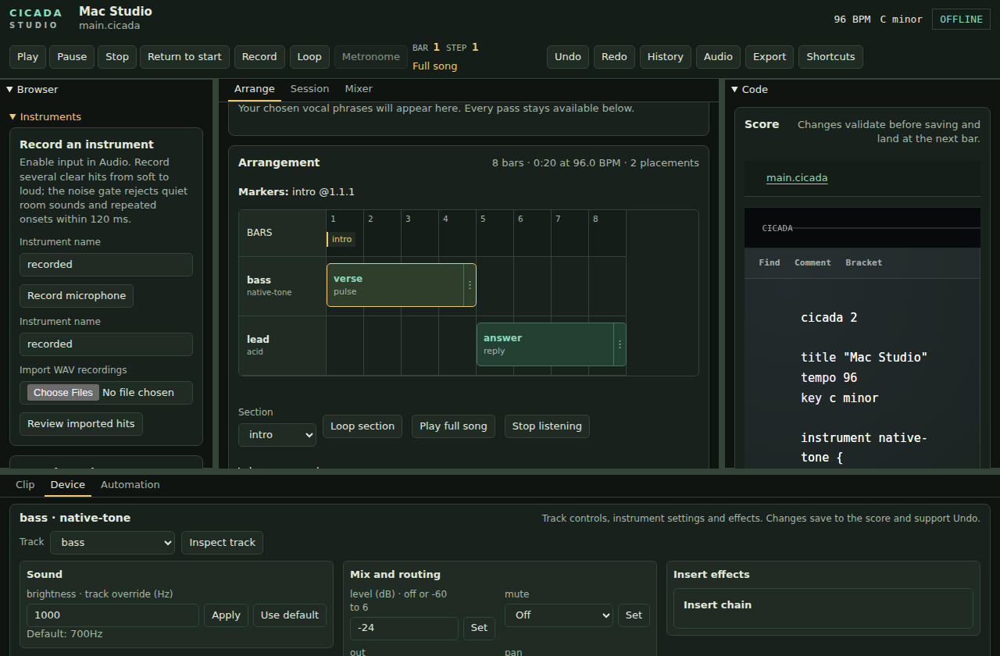
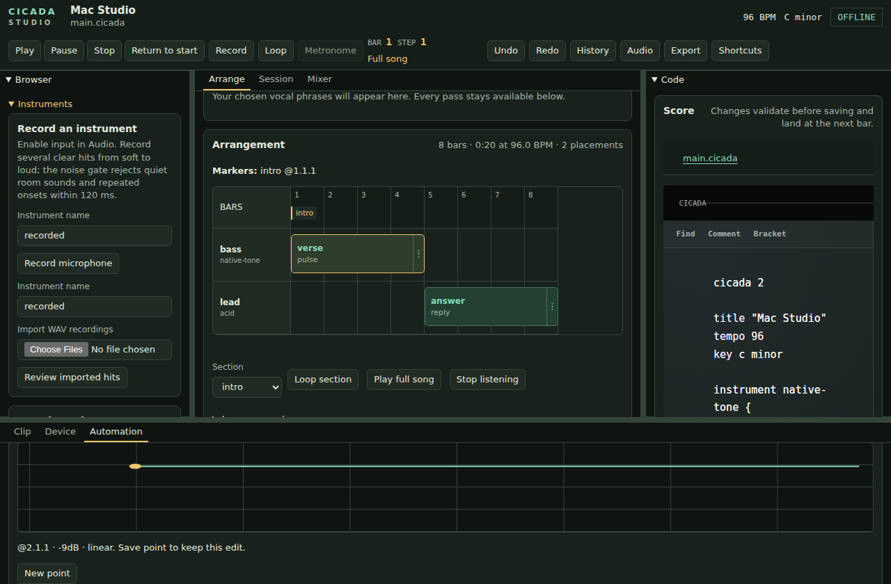

# Cicada Studio on Mac

## Open the app and a song

Unzip the Mac build and move **Cicada Studio.app** into **Applications** or
**~/Applications**. Open the app, then use **File → Open** (Command-O) to choose
a `.cicada` score. **File → New Project** (Command-N) creates a project with
its own score and assets folder. Recent projects are available in the File menu.

You can also open a score with Cicada from Finder. If another editor already
owns `.cicada` files, use Finder's **Open With → Cicada Studio**. Opening another
score switches the app to that song.

The app includes its audio engine and interface; you do not need Go, TinyGo,
or a terminal to use a packaged build. Developers can build it using the
[desktop packaging instructions](../../desktop/README.md).

Use **Arrange** for the song timeline and vocal recording;
**Session** for the launch matrix and live playing; and **Mixer** for mix
controls. **Sampler** is in the left Browser. In the bottom detail dock,
**Clip** edits patterns, **Device** shapes the selected track, and
**Automation** edits curves and scene points. The **Code** lens shows the score.

Inspect a placement to follow its track in **Device**, or choose another track
and select **Inspect track**. Instrument parameters, mixer/routing settings,
and insert controls save to the score and support Undo. Declared instruments
show their editable sound parameters; built-in voices expose their supported
mix and insert controls.

The Automation tab keeps its own scroll position. Choose a parameter, then
draw or edit points without leaving the arrangement. These screenshots show
the running Studio interface with a saved bass level point; the narrow layout
uses **Detail** in the region navigation.

[Device at 390 pixels](screenshots/studio-device-390.png) ·
[Automation at 390 pixels](screenshots/studio-automation-dock-390.png)

## Set up playback and recording

Open **Audio** in the transport toolbar. Mac builds use **Tymbal CoreAudio**.
Choose your speakers or headphones as the output, then choose your microphone
as the input. Separate built-in, USB, and audio-interface inputs and outputs
can be used together. The capture engine converts an input's sample rate to
the playback rate without changing the device's system-wide rate.

Enable **input**, apply the settings, then start a take in **Arrange**. The first
input request shows macOS's microphone permission dialog. Choose **Allow**.
If access was denied, open **System Settings → Privacy & Security → Microphone**,
allow Cicada Studio, then reopen the app. Playback does not request microphone
access when input is off.

Use **128 frames** as a starting point for recording. If the audio performance
panel reports missed deadlines or you hear interruptions, stop playback and
choose **256** or **512 frames**. The panel shows the buffer actually negotiated
with the device. Device-reported round-trip latency is an estimate; a physical
loopback check is needed to measure the complete recording path.

Input monitoring starts muted. Use headphones before turning it on, and choose
the microphone channel in the monitor controls. Device choices, buffer size,
monitor settings, and recording timing correction are remembered between songs
and app launches. A disconnected saved device remains selected so you can
reconnect it or choose a replacement.

## Record and choose takes

In **Arrange → Record vocals**, choose a vocal track or add one. Record over
the full song, or set a punch range to replace a phrase. Command-Shift-R starts
recording for the chosen vocal track and finishes an active take. The Record
button provides the same action.

Keep several takes, then use the waveform take lanes to drag across the best
phrases. These selections build the vocal comp; you can keep arranging and
auditioning without typing bar positions. See [Studio](studio.md) for recording,
punch ranges, and comp editing.

## Import a sample

Open **Sampler**, choose a **WAV file**, then use **Import and chop WAV**.
The Mac file picker selects the source; Cicada keeps it with the project and
fills the pad bank with chops. Use a pad's editor to adjust its range and sound.
See [Studio](studio.md) for sampling arrangement placements and resampling a pad
performance into the arrangement.

## Play with a MIDI keyboard

In Live, choose **Enable MIDI**, then select your keyboard or controller. The
Mac app connects through CoreMIDI, including when the embedded browser does
not provide Web MIDI. Connecting or disconnecting an input updates the list;
unplugging an input releases its held notes. Note and controller input follow
the selected Live instrument. SysEx is not supported.

## Everyday shortcuts

| Shortcut | Action |
| --- | --- |
| Command-N | New project |
| Command-O | Open a score |
| Command-S | Validate and save the score, including while typing in the editor |
| Command-Shift-S | Save As, including the project's assets |
| Command-Z / Command-Shift-Z | Undo / redo a saved edit; text fields retain text undo |
| Command-C / X / V / A | Copy / cut / paste / select all in text fields |
| Space | Play / pause outside text fields |
| Home, or Fn-Left Arrow on a MacBook | Return to the beginning |
| Command-Shift-R | Record / finish the selected vocal take |
| Command-D | Duplicate the selected Arrange placement |
| Backspace / Delete | Remove the selected Arrange placement |
| Command-L | Loop the selected placement in the song; press again to stop |
| Command-Q | Quit and stop the audio engine |

**Shortcuts** in the toolbar lists the available commands. Unsupported editing
commands are marked unavailable there.

Placement shortcuts require an inspected placement in Arrange. They leave
text fields, Code, the Browser, and the detail dock's own keys alone, and do
not run with unsaved edits or an active take. Duplicate appends a copy after
the track's existing placements. The last placement cannot be removed.
The toolbar's **Loop** button performs the same contextual loop action.

## Files and troubleshooting

Save validates a score before replacing it. An invalid edit remains a draft,
and the last valid song stays available for playback. **Save As** copies the
project's required files; copying only `main.cicada` in Finder can leave its
samples behind.

If there is no sound, open **Audio**, check the selected output, and refresh the
device list after connecting headphones or an interface. If recording is
unavailable, check **Enable input**, the chosen microphone, and macOS microphone
permission. Change device routing while playback is stopped and capture is
disarmed.

The command-line fallback `--audio oto` plays through the system default output
and does not record microphone input. `--audio null` is a silent testing mode.
Use the packaged app's normal CoreAudio mode for recording.

Settings and logs live in `~/Library/Application Support/Cicada Studio`.
The desktop log is `logs/studio.log`. When reporting a problem, include the
selected devices, buffer size, and the error shown in Audio details.

## Continuous validation

Mac PR jobs have a ten-minute maximum and run independently. Native contract
checks exercise CoreMIDI, audio permission/callback behavior, and desktop host
logic on both Apple Silicon and Intel. Go compiler and module caches are reused.

Apple Silicon also builds and signs the full Studio app from the current
revision, then tests startup, shutdown, recording controls, editor menus, and
saving a stems ZIP. Intel compiles all three native app components and runs the
real WKWebView host and native download bridge against a small fixture server.
This avoids rebuilding the same portable GoSX/WASM runtime on Intel for each PR;
the Intel host check does not claim to test the full Studio UI or render a song.

The complete signed Studio workflow sweep on **both architectures**, broad Mac
race/vet tests, and repeated DSP/WASM and size audits run nightly and through
**CI → Run workflow**. Linux PR jobs retain the broad browser, race, audio parity,
and size checks. Native smoke uses disposable projects and null audio; physical
microphone and output-device qualification remains a separate hardware check.
