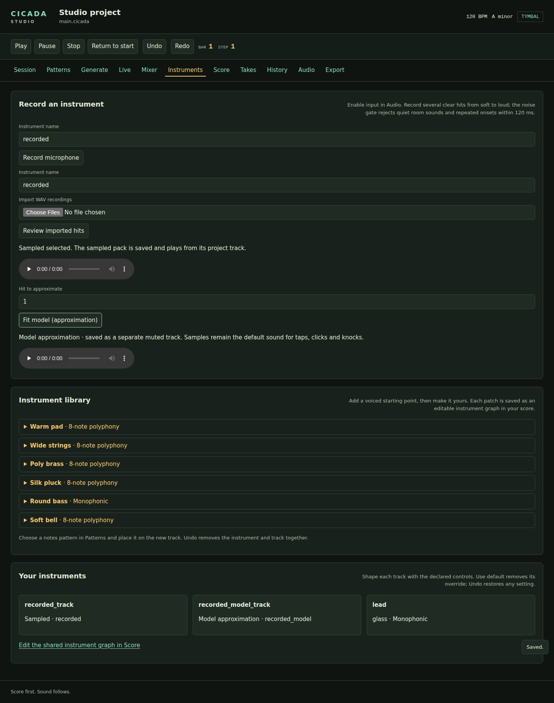

# Record your own instrument

In the Windows app, open **Instruments → Record an instrument**. Enable input
in **Audio**, then choose **Record microphone**. Record several clear taps,
from soft to loud, and choose **Stop and review hits**. The default instrument
name is `recorded`. Capture uses Tymbal's native input and the durable take
journal, with silent monitoring and no accompaniment or count-in.

You can also import PCM16/24/32 or float32 WAV files. Review the detected hits:
each has playback controls and **Remove hit**. The gate rejects onsets below
10% of the take's loudest smoothed energy or six times its measured noise floor.
Onsets must be at least 120 ms apart. Studio reports the number of hits kept.
Choose the current scene and **Build kept hits** to save the sampled pack and
add its pinned sampler declaration, track and starter pattern to the project.
**Undo** removes this score edit; the immutable pack remains available for Redo.
The portable qualification host uses browser microphone capture and the same
analysis, review, pack builder and project insertion.

The default is three velocity layers. Fifteen similar-pitch taps produce five
round robins per layer. Hits are sorted by their first 40 ms RMS before
normalization. The pack restores each hit's relative peak gain, so normalizing
the files does not erase the recorded dynamic differences. Pitch is estimated for every hit. By default, taps share the fallback root so
variations in resonance keep their round robins. Enable **Map detected note
pitches** (CLI `--auto-pitch=true`) for pitched takes: estimates with at least
80% periodicity confidence set individual note roots and tuning; unpitched hits
use the fallback root. The key map covers up to two octaves on
either side of each root, subject to source-rate and resampling bounds.

**Detected hits and pinned score declaration** shows the source-frame slices,
pitch estimates, confidence and measured loudness. **Download score** writes a
starter score beside which the pack's relative `assets/recorded/` directory
must be available. An `instrument.cicada` score is also saved inside each pack
directory and renders immediately with `cicada render`. Studio displays its
relative path. Pinned pack scores use the sampler-pack playback capability;
the recording panel's audition uses the original sample voice.



## Offline WAV packs

```sh
cicada record-pack -o assets/recorded/recorded --name recorded --root 60 --layers 3 taps.wav
cicada record-pack -o assets/recorded/notes --name notes --auto-pitch=true take-a.wav take-b.wav
cicada record-pack -o assets/recorded/taps --auto-pitch=false taps.wav
```

Put flags before file names. The command prints the hit count and the exact
sampler declaration. Packs are immutable: an existing directory is reused only
when every generated file is identical. Different contents require a new
directory. The CLI and Studio share the same analysis and writer. To turn
several pieces into one drum kit, see
[Record your own drum kit](#record-your-own-drum-kit).

Each pack contains `manifest.json`, `analysis.json`, `instrument.cicada`,
`LICENSE.txt` and one
losslessly compressed float32 WAV per hit. The manifest pins each compressed
file, decoded WAV and original input WAV with SHA-256. Its own checksum pins
the zone map and configuration. No input file names, absolute paths or device
identifiers are written into a pack. The license label is **user recording**;
it records the supplied audio's provenance and grants no public redistribution
rights.

Admission limits are 32 WAV files, 64 MiB input, 8,388,608 total source frames,
256 hits, eight layers and 32 takes per layer. Browser capture stops after
60 seconds; native capture uses the frame limit and retains its raw journal.
Incomplete capture and non-finite PCM are rejected. Capture
timing is uncalibrated; hit detection uses source-frame coordinates rather than
claiming calibrated score placement.

Your sound, room, and microphone can require a different fallback root or layer count. The panel selects one layer at a time; the sampler-pack host can blend neighbouring velocity centres when playing a pinned score.

See the [recorded desktop](screenshots/recorded-instrument-1440.png) and [mobile](screenshots/recorded-instrument-390.png) views for the controls.

## Record your own drum kit

`record-pack` makes one instrument per pack. A drum kit needs one pack for all
its pieces, each on its own MIDI note, so that a sampler can play any piece by
its note and a closed hi-hat can cut off an open one. `cicada record-kit`
builds that pack from your own takes and a short recipe. Louder hits play louder
takes, repeated hits cycle through your round robins, and the pack carries the
**owner recording** license label.

A kit usually has these pieces. The notes are General MIDI numbers, so a score
written for one kit also plays on another. Record the pieces you play.

| Piece | Note | In a score |
| --- | ---: | --- |
| Kick | 36 | `c2` |
| Cross-stick | 37 | `db2` |
| Snare | 38 | `d2` |
| Floor tom | 41 | `f2` |
| Closed hi-hat | 42 | `gb2` |
| Pedal hi-hat | 44 | `ab2` |
| Rack tom | 45 | `a2` |
| Open hi-hat | 46 | `bb2` |
| Crash | 49 | `db3` |
| High tom | 50 | `d3` |
| Ride | 51 | `eb3` |
| Ride bell | 53 | `f3` |

Any note from 12 to 95 (`c0` to `b6`) works, so a splash (55) or a second crash
(57) fits too.

1. **Choose the sound.** This step is a matter of taste; skip it for a roomier
   kit. For the dry sound of a 1970s studio, use a small room with carpet and
   blankets over the hard walls, and record no room sound: no room microphones
   and no reverb. Use old heads tuned low. Shorten the ring of the snare and
   toms with tape or a folded cloth on the head. Press a folded blanket against
   the kick's beater-side head and play it with a felt beater. A damped kit also
   suits the command, because short rings are easy to tell apart from the next
   hit.
2. **Choose the microphones.** Use one close microphone on each piece if you
   have the inputs, or move one microphone from piece to piece. These are
   starting points; move a microphone a few centimetres until the hit sounds as
   you want.
   - Kick: a dynamic microphone inside the shell, 10 to 15 cm from the beater
     head, or just outside the port hole.
   - Snare and toms: a dynamic microphone 3 to 5 cm above the rim, aimed at the
     middle of the head.
   - Hi-hats: a small condenser 10 to 15 cm above the edge, pointed away from
     the snare.
   - Crash and ride: a condenser 40 to 60 cm above the cymbal.

   With one microphone, dynamic or condenser, use it for every piece and move it
   to the distances above. Record flat, with no compression, EQ, gate or reverb.
   You can shape the sound later, in the score.
3. **Set the levels.** Record 48 kHz, 24-bit WAV files. Stereo files are mixed
   down to mono. The kit keeps the levels you record: the loudest hit anywhere
   plays at full scale, every other hit keeps its recorded level against it, and
   then the piece's `gain_db` applies. Choose one of two ways to get the balance
   between pieces.
   - **One gain for the whole session.** Record every piece through the same
     input at the same gain. Strike the piece that records loudest as hard as
     you ever will, and set the gain so that it peaks near -6 dBFS. With close
     microphones that piece is usually the snare or the kick, not the crash.
     Then leave the gain alone. The balance between pieces is the balance the
     microphone heard, distance included: the same sound is about 22 dB quieter
     from 50 cm than from 4 cm. A soft hit on a quiet piece can end up near the
     room noise. If it does, move the microphone closer or use the second way.
   - **One gain per input.** Give each piece its own input. Set each input so
     that its piece's hardest hit peaks near -6 dBFS, and write down each gain
     in dB. Choose one input as the reference. In the recipe, set each piece's
     `gain_db` to the reference gain minus the piece's own gain. With the crash
     at +10 dB as the reference, a kick recorded at +28 dB gets a `gain_db` of
     -18. A knob is rarely exact, so step 9 finishes the job by ear. A trim must
     stay within -24 to +12 dB; if a piece needs more, move its microphone or
     use the first way.

   Either way, watch the meter on the hardest hit of every piece, not only the
   loudest. A hit that reaches full scale clips, and nothing later can repair
   it. The command finds clipped hits, which are runs of samples stuck at the
   same full-scale value, and warns about them after the build. Lower the gain
   and record that take again. A peak that touches full scale and falls away is
   not clipped, and neither is a peak above full scale in a 32-bit float file,
   so the command says nothing about them.
4. **Record three dynamics of each piece, five hits each.** Soft, medium and
   hard: a light tap, a normal hit and full force. Fifteen hits make three
   velocity layers of five round robins. Put each dynamic in its own WAV file.
   The command sorts a piece's hits by the loudness of their first 40 ms and
   splits them into equal layers, so overlapping dynamics make overlapping
   layers. It also ignores any hit about 20 dB quieter than the loudest hit in
   the same file, and any hit under six times the noise floor; separate files
   keep soft hits from being ignored. If a soft take is lost in the room noise,
   the command says that the take has no hits: record it closer to the
   microphone or in a quieter room. If you play a wrong hit, record that take
   again.
5. **Leave room tone, and let every hit ring out.** Start every take with about
   three seconds of silence. The command reads the room's noise from the
   quietest 200 ms of each take. It warns you when a take does not open with
   200 ms of room tone, because the quietest stretch may then be a tail that
   was still ringing when you stopped recording, and every hit would end where
   that tail passes it. It also warns when no part of a take is quiet, or the
   room is within 20 dB of the loudest sound. Hits must start at least half a
   second apart. That is stricter than
   `record-pack`'s 120 ms rule, because bass drums and toms swell again after
   the first impact, and the command must not count the swell as a second hit.
   An attack that comes sooner than half a second is kept inside the hit before
   it, which then plays as a double strike, and the command warns you. Leave a
   second after drums. Leave cymbals and the open hi-hat all the time they need
   to die away, often 5 to 10 seconds, and keep the room quiet until then. A soft
   hit that lands on the ring of a louder one can go unseen, so check the hit
   count in step 8.

   A hit keeps its tail until the tail is 60 dB below the loudest hit in its
   file, or twice the room's noise level if that is higher. If the next hit, or
   the end of the file, comes first, the command cuts the hit there and fades it
   out over 5 ms. If the tail was still more than 6 dB above the level where
   tails end, the command warns you and gives the level at the cut. Leave more
   time and record that take again.

   A piece's takes together may hold 8,388,608 frames, which is 175 seconds at
   48 kHz or 190 seconds at 44.1 kHz. For a long cymbal, multiply the seconds
   each hit needs by the hits per dynamic and by the dynamics, room tone
   included, and keep the product under the limit for your sample rate. At
   48 kHz, a crash that needs 12 seconds a hit, played 5 times in each of 3
   dynamics, takes 180 seconds, which is too long. Four hits per dynamic take
   144 seconds and fit. The command refuses a piece over the limit and says how
   much its takes hold.
6. **Name and gather the files.** Name each file for its piece and dynamic, such
   as `kick-soft.wav`, `kick-medium.wav` and `kick-hard.wav`, and put them in one
   folder with the recipe. The names appear only in the recipe; no file name or
   path is written into the pack.
7. **Write the recipe.** A recipe is a JSON file, `kit.json`, in the same
   folder. It lists the pieces and where their takes are. This one has a kick, a
   snare, the three hi-hats and a crash:

   ```json
   {
     "format": "cicada.kit-recipe/1",
     "pieces": [
       {"name": "kick", "note": 36, "takes": ["kick-soft.wav", "kick-medium.wav", "kick-hard.wav"]},
       {"name": "snare", "note": 38, "takes": ["snare-soft.wav", "snare-medium.wav", "snare-hard.wav"]},
       {"name": "closed_hat", "note": 42, "choke": "hat", "takes": ["closed-soft.wav", "closed-medium.wav", "closed-hard.wav"]},
       {"name": "pedal_hat", "note": 44, "choke": "hat", "takes": ["pedal-soft.wav", "pedal-medium.wav", "pedal-hard.wav"]},
       {"name": "open_hat", "note": 46, "choke": "hat", "takes": ["open-soft.wav", "open-medium.wav", "open-hard.wav"]},
       {"name": "crash", "note": 49, "choke_note": 26, "takes": ["crash-soft.wav", "crash-medium.wav", "crash-hard.wav"]}
     ]
   }
   ```

   Add the toms, ride and bell the same way. Each piece takes these fields:

   | Field | Meaning |
   | --- | --- |
   | `name` | A lowercase name: letters, digits and underscores, starting with a letter. |
   | `note` | The MIDI note the piece plays, 12 to 95. No two pieces, or a piece and a choke note, may share a note. |
   | `takes` | The WAV files, written relative to the recipe's folder, such as `takes/kick-soft.wav` with no leading `./`. A piece takes up to 32 files. Two pieces may name the same file, so one recorded tom can play on two notes. A file may be a link to another file in the folder, but not to a file outside it. |
   | `layers` | Velocity layers, 1 to 8. The default is 3; set it to the number of dynamics you recorded. The piece needs at least this many hits. |
   | `choke` | A group name. A hit on any piece in the group cuts off the group's older hits within 2 ms. Give the closed, pedal and open hi-hats the same name. |
   | `choke_note` | For a cymbal: its hits ring together, and this note, which plays no sound, cuts them all off. Use it instead of `choke`, and pick a note no piece uses, such as 26 (`d1`). Play it on the cymbal's own track. A browser host needs a sampler module from the same release for a pack that uses it; older modules refuse it. |
   | `one_shot` | `true` (the default) plays each hit through, whatever the note length. `false` stops the hit, with a short fade, when its note ends. |
   | `gain_db` | A level trim for the piece, -24 to 12 dB. The default is 0. Step 3 says how to work it out, and step 9 how to adjust it by ear. |

   The command refuses a misspelled field, a field written twice or with
   capital letters, two pieces on one note, a take that is missing or holds no
   hits, and a piece with fewer hits than layers.
8. **Build the kit.** Put flags before the recipe:

   ```sh
   cicada record-kit -o assets/kits/studio --name studio session/kit.json
   ```

   The command prints a table with the hits and layers it found for each piece,
   then any warnings, then the exact sampler declaration and the path of the
   starter score. For a three-piece session of 15 hits each it prints:

   ```text
   3 pieces · 45 hits · 46 zones · owner recording
   piece       note    hits  layers (hits at first-40-ms level, dBFS)       choke
   kick        c2 36   15    5 at -28..-27 · 5 at -17..-16 · 5 at -8..-8    -
   closed_hat  gb2 42  15    5 at -36..-34 · 5 at -25..-24 · 5 at -17..-16  hat
   crash       db3 49  15    5 at -25..-24 · 5 at -16..-15 · 5 at -7..-7    note 26 (d1)
   ```

   Check that each piece shows the hits you played and that its layers sit at
   clearly different levels. The 46th zone is the silent choke note.

   A warning names a piece and the takes to record again, and the pack is
   written anyway. A clean session prints none.

   | Warning | What happened | What to do |
   | --- | --- | --- |
   | Hits were cut off while still ringing | The next hit, or the end of the file, came while the tail was still more than 6 dB above the level where tails end. The line gives the level at the cut and the level where a finished tail ends. | Leave more time after each hit, and keep recording until the last one has died away. |
   | Attacks within 0.5 s of an earlier hit | The take holds a double strike, or hits that are too close together. | Leave 0.5 s or more between hits. |
   | Hits clip at full scale | A hit holds a flat top: three or more samples in a row stuck at the same full-scale value. The input gain was too high. | Lower the gain and record the take again. |
   | A take does not start with room tone | The take's first 200 ms are not as quiet as its quietest 200 ms, so the command read the room's noise from the quietest stretch elsewhere in the take. If a tail was still ringing there, every hit ended too soon, and no cut was reported. | Start the take with three seconds of silence. |
   | A take has no quiet stretch | No 200 ms of the take is more than 26 dB below its loudest sound, and the take does not open with room tone, so the command cannot tell the room's noise from a ring that never faded. It ends tails 20 dB below the loudest sound and may miss the softer hits. | Start the take with three seconds of silence. If it already does, play harder, move the microphone closer, or record in a quieter room. |
   | A take was recorded in a room only so many dB below its loudest sound | The take opens with room tone, but the room is less than 20 dB below its loudest sound. The command finds the hits against an assumed floor, ends each tail where it reaches the room, and may miss the softer hits. | Play louder, move the microphone closer, or record in a quieter room. |

   `analysis.json` records, for each hit, whether it was cut off and at what
   level, and how many of its frames clipped.

   Like `record-pack`, the command writes an immutable pack. An existing
   directory is reused only when every generated file is identical; a changed
   take needs a new directory. The pack holds `manifest.json`, `analysis.json`,
   `instrument.cicada`, `LICENSE.txt` and one compressed WAV per hit. Its audio
   carries the **owner recording** label: you made the recordings, and, as with
   **user recording**, the label records provenance and grants no public
   redistribution rights.

   A kit holds up to 64 pieces. A piece takes up to 32 files, 256 hits, 8 layers
   and 32 hits per layer, and 8,388,608 source frames (175 seconds at 48 kHz;
   see step 5). The pack limits also apply: 256 MiB of audio after trimming and
   a 2 MiB map.
9. **Listen and balance.** Render the starter score that the build wrote, and
   listen to it at the loudness you will use:

   ```sh
   cicada render assets/kits/studio/instrument.cicada -o studio-groove.wav --bars 4
   ```

   Compare the pieces. A piece that is too loud or too quiet against the rest
   gets a `gain_db` in the recipe: -3 is a little quieter, +3 a little louder,
   and 6 dB halves or doubles the level. A pack never changes once it is
   written, so build into a new folder, such as `assets/kits/studio-2`, and
   render again. Repeat until the groove sounds balanced. The table from step 8
   shows where each piece sits before any trim. With one gain for the whole
   session it shows the balance the microphones heard. With a gain per input,
   the arithmetic of step 3 gets you close and your ears do the rest.
10. **Play the kit in your score.** The starter score, `instrument.cicada`, has
    one sampler track and a two-bar groove. To use the kit in your own score,
    copy the `sampler` block that the build printed, not the one inside the
    starter: the starter's `pack` path is relative to the kit folder, and the
    printed one points at the folder you built into.

    A sampler track plays one piece at a time. Write each hit as its note name
    from the table, and let the velocity choose the layer: with three layers,
    velocities 1 to 42 play the soft takes, 43 to 84 the medium ones and 85 to
    127 the hard ones. Velocity also sets the level, in proportion to
    velocity/127, so a hit at velocity 34 plays about 11 dB below the same take
    at velocity 127.

    ```cicada
    cicada 2
    tempo 100
    sampler studio {
      pack = "assets/kits/studio/manifest.json"
      sha256 = "0123456789abcdef0123456789abcdef0123456789abcdef0123456789abcdef"
      root = c2
      voices = 16
    }

    track drums studio { level = -3dB }
    pattern groove notes {
      c2 . gb2 . d2 . gb2 . c2 . gb2 . d2 d2 bb2 .
      c2 . gb2 . d2 c2 gb2 . c2 . gb2 . d2 . gb2 gb2
      velocity: 112 . 72 . 104 . 60 . 100 . 72 . 108 34 84 . 112 . 72 . 104 90 60 . 100 . 72 . 108 . 70 40
    }
    scene main { drums = groove }
    song { main*4 }
    ```

    Replace `sha256` with the pin the command printed. This is the starter groove.
    The open hi-hat (`bb2`) ends bar one, and the closed hi-hat (`gb2`) that
    follows it in bar two cuts it off, as a hi-hat pedal would. The soft snare
    (`d2` at velocity 34) is a ghost note from the soft layer.

A sampler track plays one note per step, so a groove on one track never hits
two pieces at once. To play the kick and a hi-hat together, add a second track
that names the same sampler. Keep the closed, pedal and open hi-hats on one
track, because a choke cuts only the notes of its own track. For the same
reason, play a cymbal's choke note on the cymbal's own track.

## Fit a playable model

After recording or importing hits, choose a **Take** and press **Fit model**.
Studio estimates up to ten resonant frequencies, their relative amplitudes and
their decay times. Studio saves both packs. **Sampled** stays selected; the model
is labeled as an approximation and added as a separate muted track. Taps, clicks
and knocks often contain noisy transients that a modal fit cannot reproduce.
Audition the approximation explicitly before choosing it for a track. The
source WAV hash and the exact trimmed-hit WAV hash remain in
`model.json`, with the `user recording` license.

The fitted voice uses the modal engine's bounded contact, resonator, glide and
four-strike variation paths. Measured ratios and decay poles replace the built-in
profile's poles. It accepts every MIDI note, omits modes above the passband, and
allocates no memory during note handling or rendering. Fitting, file admission,
WAV auditions and pack construction happen outside audio rendering.

For immediate score playback, Studio also bakes the fitted engine at five root
notes and three dynamics into a standard pinned sampler pack. The manifest pins
the model JSON checksum as well as the generated audio. **Download score** and
the saved `instrument.cicada` use this pack. Between baked roots, score playback
resamples the modal renders; decay duration changes with that resampling. Studio
audition evaluates the fitted resonators directly at the requested pitch.

The offline equivalent uses the same fitter and bank builder:

```sh
GOWORK=off go run ./cmd/cicada fit-model -o assets/recorded_model \
  --name recorded_model --hit 1 recordings/taps.wav
GOWORK=off go run ./cmd/cicada render assets/recorded_model/instrument.cicada \
  -o recorded-model.wav
```

Put flags before the WAV path. `--hit` is one-based after automatic slicing.
Fitting rejects silent, invalid or very short input. A 60 ms attack spectrum
identifies separated modes; windowed amplitude measurements estimate exponential
decay. Closely spaced modes, rapidly changing pitch, noisy rooms and nonlinear
impacts can reduce fit quality. The displayed decay confidence describes that
regression, not perceptual similarity. Try another take when a fit sounds poor.

See the [modeled desktop](screenshots/modeled-instrument-1440.png) and [mobile](screenshots/modeled-instrument-390.png) views for the controls.
