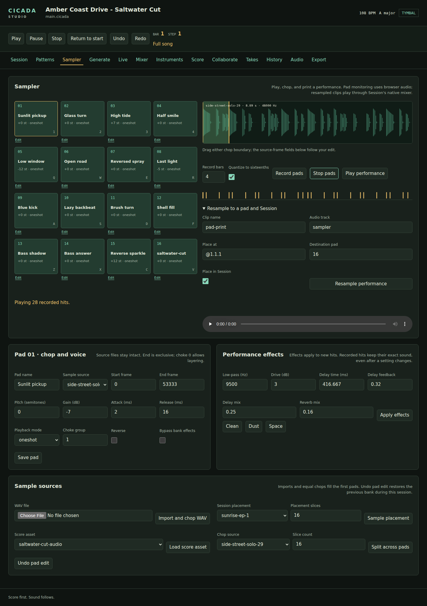
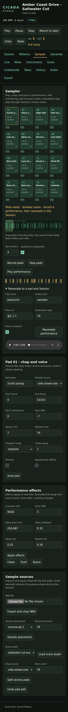

# Pad sampler

**Sampler** is a 404-style way to turn recordings or existing parts into new
music. Its sixteen pads play stereo audio in the browser. Resampling prints a
pad performance as an audio clip in **Arrange**, where it uses the song's
native mixer, placement editor, auditions, and section loops.

## Load and chop

In **Arrange**, select a placement and choose **Sample into pads** in its
inspector. Sampler opens with that placement selected. Choose 1–16 slices and
select **Sample placement** to render the isolated part into a sample. This
includes its mixer processing and brings its peak to a useful pad level.
The score remains intact.

You can also **Import and chop WAV**, **Load score asset**, or split an existing
sample with **Split across pads**. Imports fill all sixteen pads; other chop
commands fill the first requested number of pads. Chopping divides the source
into equal regions. Adjust boundaries manually for attacks or phrase endings.

Select a pad's **Edit** link. Drag the **IN** or **OUT** waveform handle, or
focus one and use arrow keys (1 ms), Shift-arrow (10 ms), or Alt-arrow
(one frame). Home and End reach the allowed limits. Escape cancels a held
drag. The waveform stays readable in narrow windows. You can also enter
start and end frames, then **Save pad**. End is exclusive. The original sample
is preserved. Pad settings include pitch, gain, reverse, attack and release,
one-shot or gate playback, and choke groups. Pitch changes playback speed and
duration. Group 0 permits different pads to overlap; groups 1–4 cut earlier
voices in the same group. Retriggering a pad also releases its previous voice.

**Undo pad edit** restores the previous bank state during the current Studio
session. It covers importing, chopping, pad settings, and bank effects.

## Play and record

Use mouse, touch, or the keyboard grid:

| Pads | Keys |
| --- | --- |
| 1–4 | 1 2 3 4 |
| 5–8 | Q W E R |
| 9–12 | A S D F |
| 13–16 | Z X C V |

Hold Shift for quieter hits. Gate pads stop when released; one-shot pads play
through their prepared sound. **Stop pads** or Escape stops playback, including
queued performance hits. Typing in an editor does not trigger pads.

Set **Record bars** and choose **Record pads**. Optional quantization places
hits on the next sixteenth so monitoring and the eventual print share timing.
The strip shows recorded hits. **Stop pads** finishes recording early while
retaining the chosen loop length. **Play performance** auditions the recorded
sounds. Selecting or editing another pad retains the performance. Leaving the
Sampler panel stops monitoring; resample before leaving to save a new take.

## Effects and resampling

Bank effects are low-pass filtering, drive, ping-pong delay, and reverb.
Use **Clean**, **Dust**, **Space**, or enter settings and **Apply effects**.
The host prepares new sounds before the pads become available. New hits use
the new settings; earlier recorded hits retain their exact prepared sounds.
This supports changes of texture within a single performance.

Choose a clip name, destination pad (0 skips pad assignment), audio track, and
musical position. Select **Resample performance**. With **Place in Session**
enabled, Studio creates an asset, clip, audio track if needed, and named
placement in **Arrange**. Regular **Undo** restores both the score and bank for
that print. Already printed pads bypass bank effects by default; uncheck
**Bypass bank effects** to process them again deliberately.

Prints end at the chosen loop length, with a short fade at the boundary. Effect
tails inside that length are included. Excess peaks receive one fixed gain
reduction to keep the print below −1 dBFS. The original performance and its
prepared sounds remain available after reopening a saved bank.

## Files and playback

The bank lives in `sampler/bank-<score-id>.json` beside the project; immutable
source WAVs and prepared sounds live under `sampler/audio` and `sampler/sounds`.
Copy the entire project to retain them. Sampler metadata is separate from score
notation; a printed clip is ordinary edition-2 score content.

WAV imports are limited to 64 MiB and 8,388,608 frames. A performance holds up to
512 hits, and the browser limits decoded pad sounds to 64 MiB. Lower pitches
and long effect tails use more space. Shorten regions or record fewer bars
when a limit is reached.

Pad monitoring uses browser audio, even when the workstation's native output
device is unavailable. Browser WASM and Web Audio are required for pad playing,
waveform dragging, and recording. Without them, native forms still edit the
bank and print its saved performance, and the selected pad has an ordinary
audio preview. Arrangement playback still uses the native output device; see
[Troubleshooting](troubleshooting.md) if that device is unavailable.

