# Cicada Studio

Studio is a GoSX workstation for projects on disk. The Windows app starts
without a score by creating an untitled project in Documents\Cicada; **File → New**
creates another project. Explicit `cicada.mod` projects can contain several
score files. Its editor, forms, navigation, meters, and live performance use
GoSX; Tymbal handles native audio devices.
Changes to patterns, mixer settings, and arrangements write back to the score.

In the desktop app, **Arrange** opens on the song timeline, with vocal recording
below it. Edition-2 scores have **Song timeline** and **Record & comp vocals**
links to jump between them.
**Session** contains the launch matrix and live playing;
**Mixer** contains mix controls. Instruments, Generate, Takes, and Sampler are
in the left Browser. The detail dock's **Clip** tab edits patterns, **Device**
edits the selected track's sound and processing, and **Automation** contains
curve and scene-point editors. The **Code** lens shows the score. Older
screenshots show these tools as standalone panels.

Studio shows **Opening Studio controls…** while its interactive controls load.
If loading takes longer or fails, **Reload Studio** offers a fresh attempt.
Save or copy unsaved edits and finish recording before reloading. Code typed
during startup remains protected when arranging controls become ready.

Browser sections keep their open/closed state through saves, navigation, and
reopening Studio.

Switching Arrange, Session, or Mixer, changing detail tabs, or choosing a
workspace region on a phone keeps your unsaved **Code** text in place.
Drag the Browser and Code separators to resize the side panels. Their sizes
fit the current window so the song workspace remains visible. Select either
panel heading to collapse it into a narrow rail; select the rail to reopen it.
Below 800 pixels wide, the region bar shows one full-width workspace at a time.
These view choices preserve your score and unsaved text.

**Sampler** adds sixteen stereo pads, waveform chopping, pitch and reverse,
effects, and performance resampling. A placement's **Sample into pads** link
opens it as a source; printed performances become regular arrangement audio
placements. See the [pad sampler guide](sampler.md).

From a source checkout, build both executables and open a score:

```sh
make build
./build/cicada studio examples/first-song/main.cicada
```

Open the printed loopback URL. Playback starts only when you select **Play**.
`--audio null` exercises transport without an output device. Tymbal is the
default on Windows, Linux, and macOS. Use **Audio** to select devices while
stopped. macOS uses Core Audio for selectable inputs, playback outputs,
and native timing reports. Windows and Linux also expose native recording
and monitoring.

On macOS, select **Enable input**, then **Apply audio settings** to request
microphone access. Device discovery never requests permission or starts
recording. Input stays closed until playback or a take starts. If access is
denied, allow Cicada Studio in **System Settings → Privacy & Security →
Microphone**, then refresh devices. Playback can continue without input;
recording refuses to arm without microphone access.

Development bundles are signed ad hoc. macOS can reject a microphone grant
from a previous build when its signature changes, even while the saved
permission switch remains on. A stable signing identity is needed to retain
authorization across app updates.

Audio device, input, buffer, and timing choices survive restarts and apply to
other songs on the same computer. Each backend keeps its own setup. A missing
saved device remains selected so playback cannot silently move to another
output. New sessions start stopped with headphone monitoring muted.

The desktop app stores these choices in the `audio` folder under its data
directory (`--data-dir` selects a separate profile). For the CLI,
`CICADA_AUDIO_SETTINGS_DIR` can select a different settings folder. Song files
do not contain machine-specific device IDs.

The null backend is silent. In WSL or on a Linux desktop using PulseAudio,
select the system output explicitly with `--audio oto`. Rendered WAV and MP3
files can also be played in your usual music player.

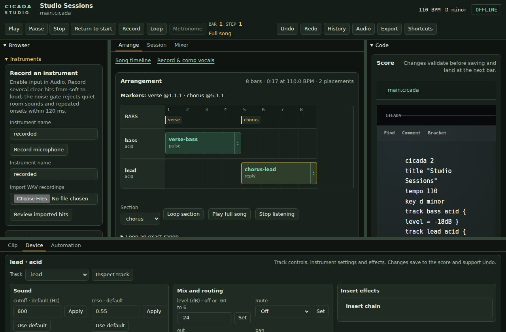

On a narrow window, choose **Center** for the
[song timeline](screenshots/studio-arrange-390.png) or **Detail** for
[Device Sound controls](screenshots/studio-device-sound-390.png).

## Transport, Arrange, and Session

**Play**, **Pause**, **Stop**, and **Return to start** control native playback.
The bar, step, backend, and errors update through GoSX live bindings. Valid
score edits become active at the next bar; during a shorter loop they become
active when the loop restarts. An invalid external edit leaves the last valid
score playing.

**Session** shows a scene-by-track matrix. Select a scene header to launch its
assignments, a pattern cell to queue one track, or **Stop** to stop a track.
Launches are quantized to the next bar. **Keep** preserves that track's slot.

**Arrange** shows scene blocks across all tracks, their bar ranges, and inherited
patterns. Click a scene header to play from that block, or a pattern clip to
open its editor. Expand a block to replace its scene, set its length, duplicate
it, remove it, or move it earlier or later.
**Add to arrangement** appends an existing scene. At least one block remains.

Scenes can live in any source listed in `cicada.mod`. Assigning a pattern or
scene recording, starting a new part, and editing scene automation update the
file that owns the scene. New part and take declarations stay in the entry
file. Undo restores every file affected by the edit. If saved sources or
libraries changed in another editor, refresh Studio before retrying.
Structural changes to songs with intervening comments require a Score edit
so those comments keep their attachment. Local scene and bar edits preserve them.

For an edition-2 score using `arrange`, **Arrange** shows named placements on
a track timeline with section markers. Select a block to open its controls.
Drag it horizontally to move it, or drag its right edge to resize it. Arrow
keys on a block or edge change its start or length by **Snap step**; hold Shift
for a whole bar. Choose bars, beats, straight or triplet divisions (T), or Off
for individual ticks. Snap changes the movement amount, preserving any existing
timing offset. Pattern starts remain on sixteenth boundaries, using the smallest
increment shared by that grid and Snap step. Audio starts and all trims allow
exact ticks. Hold Shift while dragging to bypass Snap step within these limits. Drag previews are saved only when released; Escape cancels.
Focus stays on the block or edge after saving, so arrow-key nudges can continue.
These gestures work directly in the Studio shell as well as the panel view.
Placement and marker edits also work when the arrangement is in another score
file listed by the project. They update that file; Undo and Redo restore its
exact saved text. If score files or libraries change outside Studio, refresh
before trying another edit.
Small pointer movements are treated as selection, so a click does not shift a
phrase. Save or discard unsaved Code edits before moving placements; finish
recording and wait for a pending save before starting another edit.

Option/Alt-drag a block to copy it directly to another position. Enable **Copy
drag** to do the same with touch or without a modifier. The dashed outline keeps
the original position visible; release saves one copy and selects it. Escape
cancels. Edges always trim, including in Copy drag mode. Overlapping pattern
copies are rejected with the usual form error and no score change. Snap step
and Copy drag stay in place through saves, Undo, and Arrange/Session switches.

While dragging or trimming, hold the pointer near either timeline edge to
scroll through the song. Scrolling starts after a brief pause and gets faster
closer to the edge; the placement preview follows your held pointer. Move
back into the middle or outside the visible timeline to stop scrolling.
Release to save the entire gesture as one edit. Escape restores the placement
and its original horizontal view. Changing the timeline view, hiding or
resizing the window, or switching away from the window cancels the gesture safely.

Use **Timeline zoom** for 1×–8× detail, **Fit song** for an overview, and
**Show selected** to bring the inspected placement into view. The playhead
shows the native transport position. **Follow song** advances the view
near its edge; touching or scrolling the timeline turns Follow off. Zoom and
Follow stay in place when switching Arrange and Session. Zoom and horizontal
scroll also survive placement saves and Undo in the current window. These view controls
leave the score and unsaved Code drafts unchanged.

The placement controls change the track, pattern or clip, exact **Start**,
and **Length**. Start accepts `@bar.beat.step` or exact ticks. Length accepts
bars, note divisions, or ticks, such as `4bars`, `1/8`, or `320ticks`.
**Make a copy**, **Remove placement**, **Add a placement**, and **Edit markers**
keep arrangement work in Arrange. At least one placement must remain.
Overlapping pattern placements, incompatible content, and stale writes are
rejected without changing the score; audio placements may overlap. Every edit
supports Undo. The **Placement list** shows exact starts and exclusive ends;
sub-sixteenth boundaries retain their exact ticks. Content links open the
pattern or clip editor. Returning from Score reads the current saved project.

With a placement inspected in Arrange, **Command-D** on Mac (**Control-D**
elsewhere) duplicates it after the existing placements on its track.
**Backspace** or **Delete** removes it; the last placement remains protected.
**Command-L** (**Control-L**) or the toolbar's **Loop** button loops that
placement in song context; repeat the command to stop the loop. These commands
respect text/editor focus, unsaved work, and active recording. Use Undo to
restore a duplicated or removed placement.

Choose a **Section** and **Loop section** to repeat from its marker to the next
marker, or the arrangement end. For scene-based songs, **Loop block** repeats
the selected song block. **Loop an exact range** accepts `@bar.beat.step` or
ticks for both boundaries; the end is exclusive. A loop can start between bars
and can be shorter than a bar.

Each placement offers **Audition solo**, **Audition in song**, **Loop solo**,
and **Loop in song**. Solo auditions play just that placement; song-context
auditions play every part active over the same range. Solo listening keeps the
song's tempo changes and full automation curves, including points after the
selected phrase; it also isolates overlapping audio clips on the same track.
Once-through auditions
stop at the placement's exclusive end. These controls use native playback and
leave the score, mixer solo/mute settings, and Undo history unchanged.

The transport shows the target, mode, and exact boundaries. **Pause** retains
the selection; **Play** resumes it, or restarts a completed audition. Moving
or trimming a placement, moving a section marker, and Undo update the selected
listening range at the next bar or loop restart. Removing the target stops
playback. **Play full song** restores all parts and starts at the beginning;
**Stop listening** clears the listening selection and stops playback.

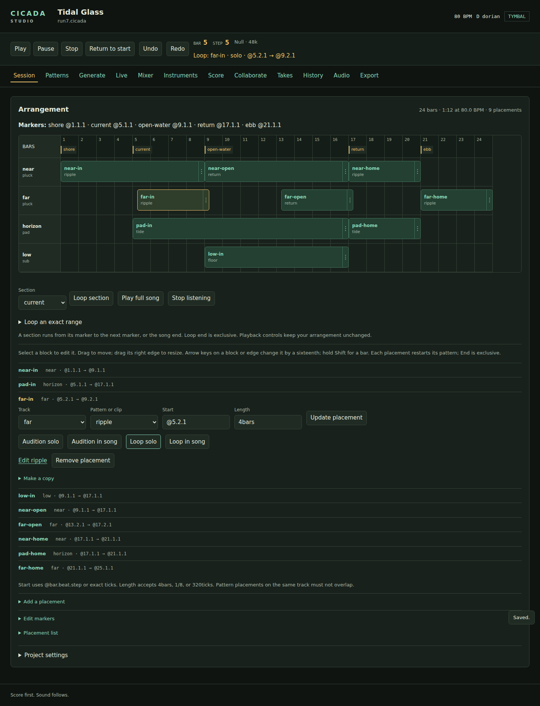

**Project settings** changes the title, tempo, key, and scale. Tempo keeps up
to three decimal places. Changing the key retunes scale-degree notes; explicit
letter pitches keep their pitch. Every edit validates and checks the current
disk revision before saving, and has an Undo entry.

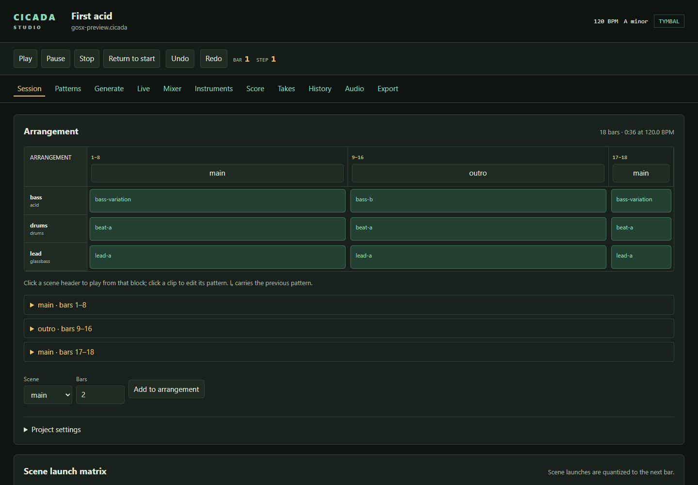

**Automation → Scene automation** shows parameter lanes alongside the song's scene
blocks. Choose a parameter and **Inspect parameter**, then choose a scene and
**Add or replace point**. Track level and pan, sends, supported synth controls,
and effect parameters use the shared parameter catalog. Values accept their units
(for example `1.25kHz`, `250ms`, or `-6.25dB`), and controls report the allowed
range and alternatives. Existing points can be edited or removed.

A point applies each time its scene starts, with the engine's parameter
smoothing. **●** marks an explicit point; **↳** carries the previous value.
Removing a point keeps that inherited value; add the score's default value
explicitly to reset it. Repeated uses of a scene share its points. Playback,
seek reconstruction, WAV exports, and stems use the same scene settings.
The scene tempo (`tempo`) can be added, changed, and removed the same way; it steps at the scene boundary and the arrangement length is the sum of the steps. Edits preserve surrounding source comments and support Undo. Scene lanes place
points at scene boundaries. **Automation curves** edits continuous `automate`
lanes across song or arrangement time: choose a parameter, double-click to add
a point, drag points, or use arrow keys. Points snap to sixteenths and stay
between their neighbors. **Transition** selects linear, smooth, step,
exponential or tension-controlled curves. **Save point** makes one Undo step;
**Remove selected point** removes it. Escape cancels a drag. The numerical fields
retain unit-aware entry, and **All saved curves** shows the complete overview.
Existing curves are edited in the project file that owns them. **Curve recalls**
lists positions where playback returns to the curve after a live adjustment.
In Code, add `recall @7.1.1` inside an `automate` block to set such a cue without
changing the curve's shape. A recall must fall on a sixteenth at or after the
lane's first point and within the song. Recall positions must be unique.
To record a movement, choose the parameter, start native playback, and click
**Record movements**. Move **Perform** with a pointer or the keyboard, then
**Keep recorded curve**. The saved points use the sixteenth-note grid and remain
editable; one Undo restores the previous curve. Replacing an existing lane
requires **Replace saved curve**. Only the selected parameter is replaced.
**Discard pass** releases its temporary live adjustment without changing source.
A loop restart, backwards seek, or changed playback ends the pass. Keep or
discard it before starting another. A retained pass survives reopening Studio;
a conflicting source edit leaves it available for recovery. This is one-parameter
Write recording; Touch/Latch modes are not yet supported. To record a movement
while recording audio, start the audio take first, then start the automation
pass. Finish the take before keeping the curve. Keeping the curve is one Undo
step; the recorded take remains separately available.

On a track with exactly one amp insert, the playback amp's
Drive, Tone and Output are available in the parameter picker. **Automate Drive**,
**Automate Tone**, and **Automate Output** in the track's guitar sound controls
open the matching curve. Automation belongs to the track even if its amp
declaration is shared; changing the declaration itself affects its users.
These curves normally change the track's playback, while input monitoring uses
separate settings. To hear the movement on the input while recording, select
the destination track's amp parameter and choose **Link Perform to the live
input amp**, then choose **Prepare linked recording** before starting the
audio take. Use **Record take** in Session and move **Perform**; the linked pass begins
with recording. The monitor temporarily follows the track amp and cabinet and
its other saved amp curves; other track effects are
heard only on playback. The monitor's previous settings return after
the pass. Choose one recording pass; linked Write is unavailable during
multi-pass loop recording. The take stays dry and uses the selected mono or
stereo input. Changes
follow at the device period and through
the amp's smoothing, so this does not promise sample-identical monitoring or
physical input latency. The movement control starts from the saved value at the
pass's grid position; it is not a continuous meter of playback changes.

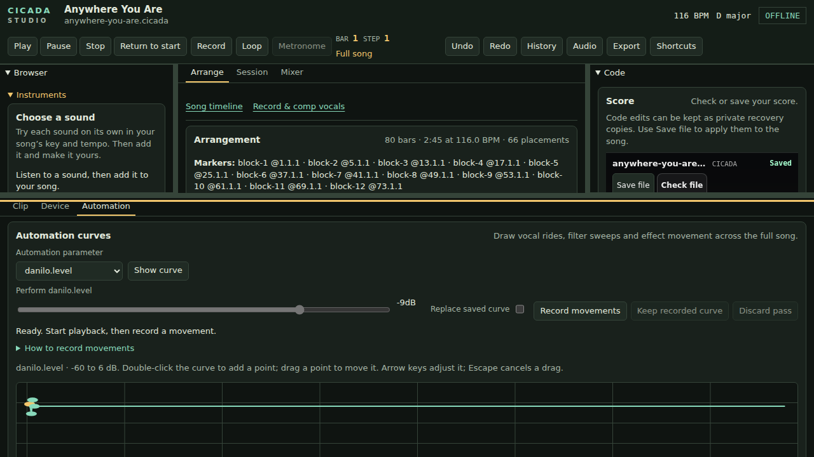

The controls also wrap in the [phone Detail view](screenshots/studio-elastic-automation-390.png).
[Verification report](verification/studio-elastic-automation.json) records the
synthetic-fixture checks and physical-audio limits. To reproduce the native check,
create a fresh fixture with `CICADA_ELASTIC_ALBUM_FIXTURE=/absolute/new/directory
go test ./cmd/cicada -run '^TestElasticAlbumWorkflow$' -count=1`, then use
`desktop/smoke.py --mode normal --app /path/to/Cicada\ Studio.app --output /path/to/proof
--project-fixture /absolute/new/directory/anywhere-you-are.cicada
--workflow desktop/testdata/native-elastic-automation-workflow.js --timeout 90`.
The smoke app uses null audio, isolated browser/state directories, and a disposable
project copy. It never opens a microphone or edits the original project.

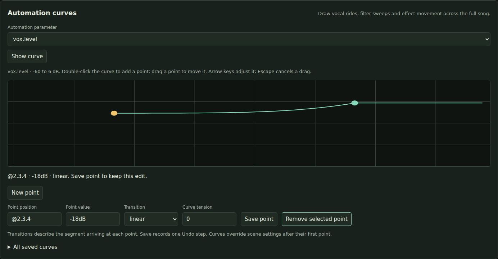

The editor also supports [touch editing on phone screens](screenshots/studio-producer-automation-390.png).

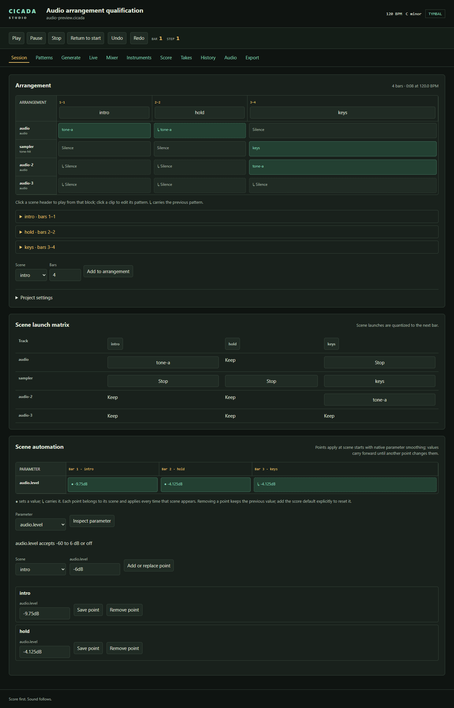

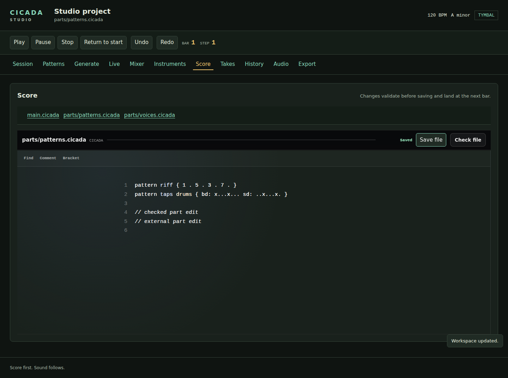

## Patterns

Use **Create pattern** in the pattern editor to start a new grid. Choose its
track, name, and length (1–64 steps). The track supplies the appropriate notes,
acid, or drum pattern type, including a custom kit's lanes. Choose a scene to
create and assign together in one Undo step, or **Library only** to leave the
arrangement unchanged. The new grid opens immediately for editing. An authored
instrument's card also offers **Create pattern** for that track.

**Start with** keeps the grid empty or fills it with an editable idea: a
**Pulse**, an **Arpeggio**, **Held chords** for a polyphonic instrument, or a
drum **Backbeat**. Pitched ideas follow the song's key and the sound's home register,
including a track octave override. Backbeats use the kit's kick, snare, and
closed hat when present; other kits receive a pulse on their first lane.
The notes and any scene assignment share one Undo step. Existing parts and the
arrangement stay intact unless you choose to assign the new pattern to a scene.

Pause the song, choose a compatible track under **Hear with**, then press
**Loop part** to hear the selected grid or played performance on its own.
Library-only patterns can preview before you assign them to a scene. The
preview preserves your paused song position, score, Undo history, and unsaved
Code draft. Press the same button or Escape to stop. Changing **Hear with**
stops the previous preview; press **Loop part** again for the new sound.
Saving changes stops the old loop so you can restart with the saved notes.

In a notes grid, select a step and open **Build a chord** in its inspector.
Choose the root, chord type, root octave, inversion, and **Hold (steps)**.
**Place chord** writes the onset and holds in one Undo step. It replaces that
span; shortening clears its old trailing holds while keeping the next onset.
Use a polyphonic sound, such as Warm pad, for a chord's two to four voices.

Every chord tone appears in the grid. In Draw mode, click one to remove it or
another pitch at that step to add a voice, up to four. The inspector's **First
pitch** moves the whole voicing. Range transposition and variations also retain
all its voices and shared dynamics.

In **Variations and scene assignment**, **Assign to scene** plays the selected
pattern on the chosen track. **Stop in this scene** releases that track;
**Carry previous pattern** keeps its previous selection. Scene choices carry
forward until a later scene changes or stops them. Each assignment has Undo.

Choose a pattern from the library. The piano roll shows pitched patterns;
drum patterns show their authored lanes.

With browser scripting on, the **Piano-roll tools** start on **Select**. Click
a cell to inspect its step without changing it, or double-click an empty cell
to add a note or hit. Choose **Draw (B)** and a click writes or erases a cell.
Press **B** to switch between the two tools. With a cell focused, **Delete** or
**Backspace** clears its step, and the left and right arrow keys select the
neighboring step. In a notes pattern, with the selected note's cell focused, the
up and down arrows transpose it by a semitone; hold **Shift** for an octave.
Without browser scripting there are no tools: a click on a cell writes or
clears it. In either mode, choose a step number (starting at **1**) to inspect
that step without changing it.

**View register** moves the piano roll to another octave; the editor reports
notes outside the displayed register.

The step inspector sets note, tie, or rest; MIDI pitch; accent and slide;
ratchet from 1–8; and chance from 1–100%. Drum hits offer velocity levels
**1–9**, normal **x** (100), or accented **X** (127). Melodic dynamics use the
voice's accent behavior. **Pattern timing** edits swing, gate, and transpose,
and resizes patterns to 1–64 steps. Shortening removes the ending steps from
every lane; Undo restores them.

**Range editing** copies, clears, reverses, rotates, or transposes selected
steps. Copy writes at its destination without extending the pattern; overlapping
copies read the original range. Rotate wraps inside the selection. Transpose
changes note pitches while retaining articulation, rests, and ties. Drum lanes
support the first four operations. Each operation commits as one Undo entry.

**Create variation** duplicates a pattern with independent notes and no reserved
slot. Its current pitches are written explicitly, including a custom voice's
home octave. **Assign to scene** places it on a compatible track. Editing a
phrase-based pattern expands its phrase uses locally, preserving the shared
phrase and other patterns. Comments inside a phrase-use expression require a
Score edit instead of being discarded.

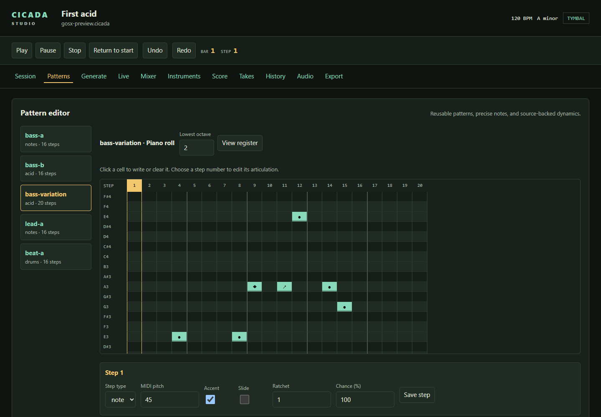

## Phrase generation

**Generate** creates deterministic bass phrases from a 64-bit seed, key,
scale, structure, voice, density, articulation, swing, and gate. The voice is
FM bass unless you choose another keyboard patch, the piano, or acid. Eight
scales and 8, 16, 32, or 64 steps are available. Seeds remain exact even above
JavaScript's integer precision limit. The articulation settings write accents
and slides for every voice, but only acid sounds an accent.

**Preview phrase** leaves the open score unchanged. The preview belongs to
your browser session and expires after thirty minutes. Open **Mutate or evolve
the first bar** to select an operation or generation index. Check the steps
that must remain locked. A variation preserves those steps and the preview's
other patterns and arrangement. If an operation requires changing a lock,
Studio reports the conflict.

**Replace open score with this phrase** applies the complete reviewed preview.
It checks the original revision; it cannot overwrite another editor's save.
**Undo** restores the previous score.

## Live performance

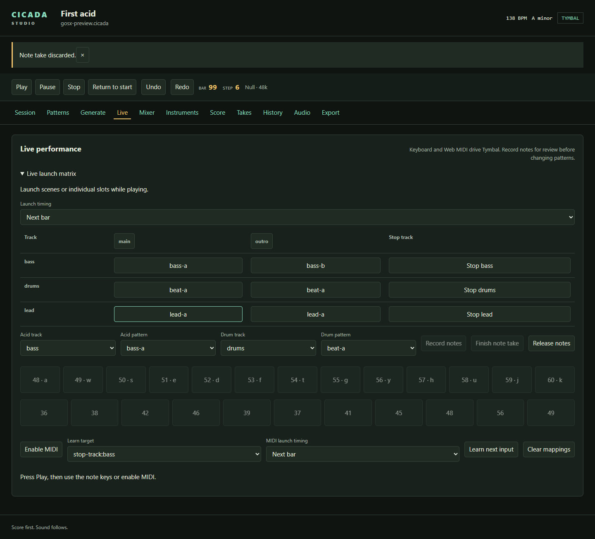

**Live** plays the **Pitched track** you choose from the A/W/S/E/D/F/T/G/Y/H/U/J/K
keys or the onscreen keyboard. That list offers the piano, the modeled
keyboards, authored instrument tracks, and acid tracks; audio and sampler tracks
are not offered. The drum pads play the **Drum track** you choose and use General MIDI
notes. Press **Play** first; changing tracks, leaving the panel, or losing focus
releases held notes, and **Release notes** releases them on demand.
The launch matrix queues scenes or individual slots with the selected timing;
mint marks a playing slot and amber marks a queued slot. Its forms also work
without browser scripting.

**Enable MIDI** connects the macOS app directly to CoreMIDI when Web MIDI is
unavailable. Inputs appear automatically when connected and disappear when
unplugged; their held notes are released. **Disconnect MIDI** closes the input
port. Leaving Live or closing the app also closes it. Bluetooth MIDI inputs
already connected in macOS appear through the same CoreMIDI path; Cicada does
not pair Bluetooth devices.

Held notes keep a short lease in the audio service. If the Live client crashes
or stops responding, the service releases its notes after five seconds and
rejects late commands from that client. Notes held by another connected Live
client continue sounding.

In browsers with Web MIDI, **Enable MIDI** asks for browser permission without
system-exclusive access. Both paths retain note on/off, control changes, pitch bend, channel and
polyphonic pressure, sustain, and MPE setup. Notes play the selected pitched
track. On channel 10, General MIDI drum notes play the selected drum track and
other notes are ignored. Live honors All Sound Off and All Notes Off for the
sending device and channel. The selected expression mode separates ordinary
channel controls from MPE member and master controls. The native input requests
MIDI 1 protocol conversion from CoreMIDI; it does not claim MIDI 2 expression
support. Web MIDI also supplies MIDI 1 packets. System-exclusive messages are ignored.

#### Record and Arm

Select a parameter, scene, slot, track stop, or transport target, then **Learn
next input**. Parameters learn controller messages; launches learn note
messages. **MIDI launch timing** chooses next beat, next bar, or one, two, or four
bars. Mapping and track selections are saved in this browser. **Clear mappings**
removes them. Browsers without Web MIDI can still use keyboard and drum pads.

Choose the **Pitched pattern** and **Drum pattern** destinations. Each picker
lists patterns on that track first, then unused compatible local patterns marked
**library**. Use **Create pattern** in Live to make an empty library pattern
without assigning a scene. A pattern used only by another track is not offered
as an unused destination. Imported patterns need a local copy before recording;
patterns in another project source still require that file's revision receipt.

Press **Play**, then select **Record notes**. **Finish note take** retains a private copy for
review. The trace shows original note starts, held lengths, and velocities;
**Inspect notes** shows exact timing at 960 ticks per beat. Estimated releases
are marked. A local desktop profile also keeps interrupted takes and recovery
copies across restarts; closing a browser tab does not apply a take to the score.
Keeping a take replaces its selected patterns. An unused destination stays in
the library and uses no launch slot until you arrange or assign it. The take is
checked against the selected sound again before commit; unsupported notes or
expression leave the retained take available for review.

Transport observations retain the time and tempo of the rendered position.
Polling an old observation does not refresh its clock. Native MIDI correlates
that time with the input timestamp; browser clocks include the reported render
age and estimate response transit from half the request's round trip. Note
timing extrapolates at most 250 ms from the observation. An upcoming authored
bar tempo is carried with the observation when it is within 350 ms, so notes
and playheads cross that boundary at the new tempo before the next poll. This
does not predict a later live edit or scene launch. A moving playhead
becomes unavailable when its audio clock stops updating; a paused position
remains visible. This software alignment does not measure device latency.

**Keep played timing** writes independent note starts, releases, velocities,
and supported controller gestures as a performance pattern. Chords can have
different starts, held lengths, bends, pressure, and timbre. MPE member controls
remain attached to individual notes; master bend, pressure and timbre become
shared lanes. Ordinary MIDI channel bend, channel pressure and CC74 use a
shared lane too; polyphonic aftertouch stays with its note. Channel pressure
and polyphonic aftertouch remain independent, with the larger value heard.
Movement after note-off is retained without stretching the gate.
Finish the take after the release-tail movement you want to keep.
All destinations use the first note or shared gesture's bar as a common
origin. The final release or shared movement rounds the loop up to a whole bar.
A zero-length hit gets a one-tick gate. Existing pattern transpose, swing,
and gate settings do not alter the
captured pitches or timings. Scene assignments and the song's lengths stay as
authored; a short song block can end before a long performance finishes.

In **Patterns**, select the performance to inspect its trace, edit each note's
MIDI pitch, start tick, end tick, and velocity, add or remove notes, or change
the loop length. **Note gestures** shows the selected note's held controller
values. Select a point to edit its tick after the note starts, bend in cents,
pressure, timbre, vibrato depth, and rate. Add or remove points with Undo.
Large takes use a paged table; the overview retains local extrema without
changing the recorded data. Moving a note carries its gesture offsets.
Shortening refuses to discard held notes or gesture points. Choose **Hear with**
and **Loop part** to audition its full loop independently of the arrangement.
Each edit has Undo. WAV, stems,
MIDI, and the portable audio kernel retain the performed gates and velocities.
WAV and stems render the gestures. MIDI exports them as independent MPE
channels with MIDI 1 controller precision; see [MIDI export](exporting.md).

Grid notes, chords, drum hits and dynamics, range edits, timing and resizing
save to the pattern's owning project file. Drum lanes and shared-phrase guidance
remain visible when their definitions live in another file. Rapid drawing and
Undo advance through their own confirmed saves; an outside source save stops
queued gestures for an explicit refresh. Failed grid inputs stay available
beside the editor's feedback. Imported definitions need a local variation first.

Performed note edits, individual and shared gestures, lane creation and binding, and
loop-length edits save to the project file that owns the performance. Each
change has one Undo step, including phrases in secondary files. Studio checks
the full project version shown by the form; an outside save refuses the edit
and keeps the outside file intact. Inline feedback keeps failed inputs
available to review before refreshing. Imported library definitions remain
protected; create a local variation before editing them.

**Hear with** stays with the phrase as you select and edit notes, individual
gestures, shared lanes and timing. Changing the audition sound keeps local
draft inputs mounted and adds no browser history entry. The choice is carried
in the editor URL for refresh and reopening; it does not change the song's
track assignments. Destination pickers remain independent choices.

**Shape pitch** develops a played melody without editing notes one by one.
**Shift notes** moves every note by a nonzero −48 to +48 semitones. Select a
note, then **Mirror around** that pitch to turn rising intervals into falling
ones and falling intervals into rising ones. Chords mirror with the melody.
Timing, gates, velocity, shared lanes, vibrato and recorded pitch bends stay
as played; mirroring note intervals does not reverse a bend's direction.
The editor refuses a transformation that would put a stored or sounding
note outside MIDI 0–127, including the pattern's existing transpose. Each
operation has one Undo step and affects every use of the pattern. Create a
variation first to keep the original. Imported phrases offer that local-copy
workflow instead of changing their library.

**Shape time** develops a played phrase at a different pace: choose half,
two thirds, one and a half, or twice its current duration. The loop, note
starts, gates, individual gestures and shared gesture lanes move together.
Pitch, velocity, controller levels, vibrato rate and project tempo stay the
same. **Loop part** auditions the new full loop; one Undo restores the exact
previous score. Owned secondary score files are supported too.

Times round to the nearest tick. Controller samples that land on the same
tick keep the later value; every note retains at least a one-tick gate.
Compression refuses overlapping repeated pitches instead of discarding notes.
Existing song blocks keep their start and length, so lengthen a block when
you want to hear a newly expanded phrase in full. Make an independent variation
first when only one use should change. Imported library patterns remain
unchanged; **Create a local variation** opens their variation form directly.

Open **Use this pattern** in either the grid or played-timing editor to bring
the phrase into your song. **Create variation** copies the complete pattern
without changing its existing uses. This also works for unused patterns in
secondary files and pinned libraries. **Hear with** chooses the sound whose
register resolves the copy's relative notes; that sound stays selected when
the local copy opens. The copy contains resolved notes, phrases, timing and
gestures, with absolute pitches and a free slot when assigned. Instrument
settings remain shared. A sound check confirms that creating the copy leaves
the existing song intact. The original files and library pins stay unchanged;
one Undo removes the local copy. For a scene song, choose a compatible
track and scene, then **Assign to scene**. The assignment replaces that track's
part everywhere the scene is used; Stop releases the track and Carry keeps
its earlier selection.

The grid editor shows its cell timing and full loop duration. Triplet,
dotted, and tuplet grids keep their authored timing; fractional beats are shown
exactly. The step numbers count cells, whose lengths can differ between patterns.

For a named arrangement, **Place in song** adds a use of the selected pattern.
Its default start is after the last placement, and its length is the phrase's
exact loop length, including its authored grid. Choose another start or length
before placing it. Existing uses link to their arrangement blocks. Editing a
pattern changes all its uses;
create a variation first when you want an independent phrase. Assignment,
placement, and variation each have one Undo step.

To develop just one block, select it in a named arrangement and use
**Vary this phrase** → **Make independent variation**. The new local pattern
replaces that block's content while its start, length, track and other uses
stay intact. **Edit _name_** then opens the copy in the pattern editor. Its
notes, velocities, gestures, grid and timing remain editable. Sound settings
still belong to the same instrument.

The copy includes the resolved musical material, so a phrase in another
project file or an imported library can become an editable local variation.
The copied notes use their current absolute pitches.
The original definitions and library stay unchanged. A render check verifies
that creating the copy preserves the song's sound; a failed check saves
nothing. One Undo restores both the pattern and the placement assignment.

**Shared gestures** lets one lane shape several notes and their release
tails. Create a lane, select each note and choose **Bind note**, then edit
the lane's bend, pressure and timbre points. Times are measured from the loop
start. Moving a note keeps its binding and leaves the shared curve in place.
Each note retains its own gestures and vibrato. Bend adds, pressure uses the
larger value, and timbre adds around its neutral center of 0.5. The curve
starts neutral on each loop unless a point at tick zero sets its initial
values. Unbind all member notes before removing a lane. Every edit has Undo.
Live MIDI capture creates these lanes automatically, with separate identities
for each input, ordinary channel or MPE zone, and reconnect. Ordinary channel
lanes are named `midi-1`, `midi-2`, and so on; MPE lanes use `mpe-1`, `mpe-2`.
The retained-take review shows each lane's
membership, point count and final movement. Keeping played timing coalesces
samples at the same musical tick; private recovery keeps every raw sample.
Lanes that stayed neutral need no binding in the saved pattern. Shared movement
requires **Keep played timing**; the step-grid option refuses to discard it.
During live input, ordinary channel and MPE master controls keep shaping
release tails on authored synths and acid. Note controls freeze at key release,
including polyphonic aftertouch under sustain. Reconnecting an input starts
a separate shared address; old tails retain their last controls. The saved lane
uses the same layering during playback and export.

Played timing supports modeled keyboards and piano, authored pitched
instruments, and acid, using each instrument's existing mono or polyphonic voice policy.
It supports up to 512 notes and 65,536 gesture samples per pattern, subject
to playback density limits. Acid keeps pitch and vibrato; authored synths
also expose pressure and timbre to their graph. Polyphonic authored synths
with gestures use the four-voice pool and its existing stealing policy.
Modeled piano and keyboard voices currently accept notes without gestures.
Both timing choices write each destination in its owning project file, including
takes spanning several files. One Undo restores the whole take. Imported library
sources remain read-only; create a local variation before recording into them.
Overlapping gates of the same pitch need separate
tracks. Drum, sampler, and unsupported expression performances are refused
with the retained take intact. Values hold between gesture points. Capture
coalesces samples at the same musical tick to their final state while the
private raw take keeps every original sample. For step patterns, expand **Snap to the
existing step grid** and choose **Commit notes to patterns**. This quantizes
starts, uses the destination's saved length, and checks for collisions before
writing. Drum hits retain their separate lanes in this grid workflow.

**Check current patterns** validates both timing choices without changing the
score. A take remembers the project version from the start of recording, even
if another editor saves while a note is held. Review warns when any source has
changed or an older recovery copy has no project version. Check the current
instrument and destinations before keeping played timing or choosing
**Apply notes to current score**. A further save refuses the edit and retains
the take. **Undo** restores the previous pattern source;
**Discard note take** closes the retained copy without writing notes. Recovery
history remains private to the workspace owner.

## Mixer and instruments

Select a placement and open **Device** to shape its track, or choose another
**Track** and **Inspect track**. **Sound** includes controls for built-in voices
and declared instrument parameters. Units, ranges, and menu choices show the
values each control accepts. **Apply** saves the setting; **Use default**
removes that track's override. Each change supports Undo. **Mix and routing**
and **Insert effects** have their own controls below Sound.

**Mixer** edits track, bus, return, effect, and master fields supported by the
source patcher. Each **Set** writes one parameter. Unsupported fields explain
their limitation and remain available in **Score**.
Ranges, units, enum choices, and On/Off controls come from Cicada's parameter
registry. Existing track sends are included in their mixer strip.
Audio tracks offer **Add vocal chain**: a high-pass EQ, compressor and de-esser
in that order. A second click retains the existing vocal chain. Use the ordered
**Insert chain** controls to move or remove stages, and follow each effect name
to its parameter controls. These processors have independent state per track;
changes are saved and recompiled. Finish a vocal take before changing saved
mixer settings. See [track inserts](../audio/mix-chain.md#track-inserts) for
processor syntax and supported controls.

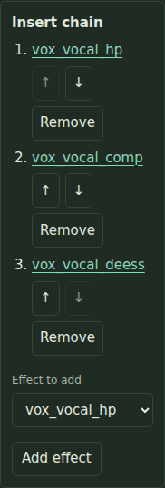
For an edition 1 score, first check **Upgrade score to edition 2 for this change**.
The domain service performs the migration and parameter edit together.
#### PCM capture and shared sampler audition

For tap slicing, velocity layers and round robins, use **Record your own
instrument** in the Record panel. See [recording instruments](recording-instruments.md)
for microphone, WAV import and offline pack commands.

Add an edition-2 audio track and a scene, stop transport, and open **Record**.
Choose the target **Audio track** and **Scene** before arming. The backing
includes synths, samplers and existing audio clips; capture retains device input
before monitoring and mixing.
The GoSX meter surface shows track and master peaks, RMS, momentary,
short-term and integrated LUFS, loudness range, true peak, and dropped blocks.
**Reset live loudness** begins a new measurement. The surface stops polling
when you leave the mixer. Offline export still provides the final loudness
verification.

**Instruments** offers six starting patches: Warm pad, Wide strings, Poly brass,
Silk pluck, Round bass, and Soft bell. **Add instrument and track** saves an
editable graph and its track in one Undo step. Five patches have eight-note
polyphony; Round bass is monophonic. Choose the new track in **Live** to play
it using the on-screen keyboard, typing keyboard, or MIDI. Bind a notes pattern
in **Arrange** to sequence it and include it in WAV exports.

Declared parameters show their default and current track override. Apply a
value to shape just that track; **Use default** removes its override. Values
use the parameter's declared unit. Each change is revision checked and can be
undone. Edit the complete graph in **Score**. Notes patterns support two- to
four-pitch chords, editable in the grid or source. **Keep played timing** stores captured chords with independent note lengths;
step-grid commits continue to check for collisions before writing.

## Score and history

The local Studio profile keeps private Code recovery copies while you type.
Wait for **Recovery copy kept on this device** before closing or switching
projects. This keeps a draft; **Save file** applies it to the song. Playback and
exports continue to use saved music. A restart restores the most recent copy
for each file, including unfinished syntax. **Other recovery copies** opens
versions kept by another window. Saving or discarding the selected copy does
not erase a different window's changes. If the saved file changed, review the
current file before choosing **Save combined draft**.

The **Code** lens opens a score editor with live syntax highlighting, a gutter,
and two-space indentation. **Tab** indents and **Shift-Tab** unindents the current
line or selected lines. **Enter** carries indentation into the new line and
indents inside braces. Editing incomplete notation keeps the text visible;
highlighting does not save or change the playing song.

Use **Command-F** on Mac (**Control-F** elsewhere) to find text. Replace uses
**Command-Option-F** on Mac or **Control-H** elsewhere. **Command-/**
(**Control-/**) toggles line comments. While the score text has focus,
**Command-Z** / **Command-Shift-Z** (**Control-Z** / **Control-Shift-Z**)
undo and redo text edits, including indentation and replacement. The Mac
**Edit** menu uses the same text history. The Studio toolbar's **Undo** and
**Redo** operate on saved project edits.

Typing in Find keeps the search field focused. **Enter** or **F3** visits the
next match; **Shift-Enter** or **Shift-F3** visits the previous match and wraps
at the ends of the file. **Replace** changes the selected match first; each
replacement can be undone as one text edit.

Use **Go to line** or **Control-G** on every platform to jump within a long
score. Enter a line number, or `line:column`, then press **Enter**. Lines and
columns start at one, and columns count Unicode characters. Columns past the
end of a line land at its end. An invalid line stays in the jump field with an
explanation; **Escape** returns to the previous selection and scroll position.
Navigation never saves or changes the score.

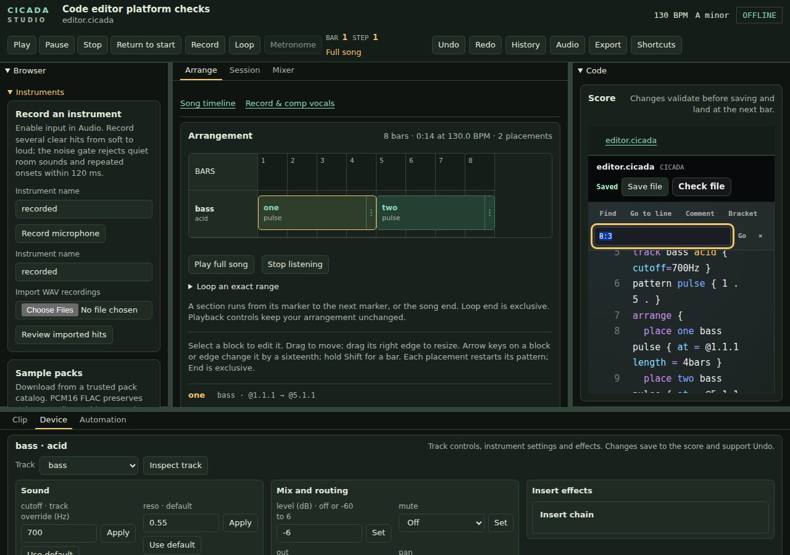

Jump controls and validation also fit the [Code pane on a phone](screenshots/studio-code-navigation-390.png).

A project with several source files opens from any listed score, and the Code
lens lists every file. Select a project file, edit it, then use **Check file**
to review diagnostics without saving or **Save file** (**Command-S** /
**Control-S**) to validate and write that file. Other score files retain their
exact bytes. External changes refresh clean editors and project views; unsaved
drafts remain available for an explicit merge. Saved revision files live in app
data, with late writes from other editors retained. Checking or rejecting a file
retains its draft across reload and navigation, independently of drafts in other
project files. These recovery drafts expire after thirty minutes or when Studio
closes.

A successful **Check file** says **File check passed. Draft is not saved.**
It clears validation failure feedback while leaving your song on disk unchanged.
Reloading a retained draft shows **Recovered draft. Not saved to disk.**
The editor shows **Unsaved** as you type, including after a successful check.
**Save file** writes the draft and clears that recovery status.

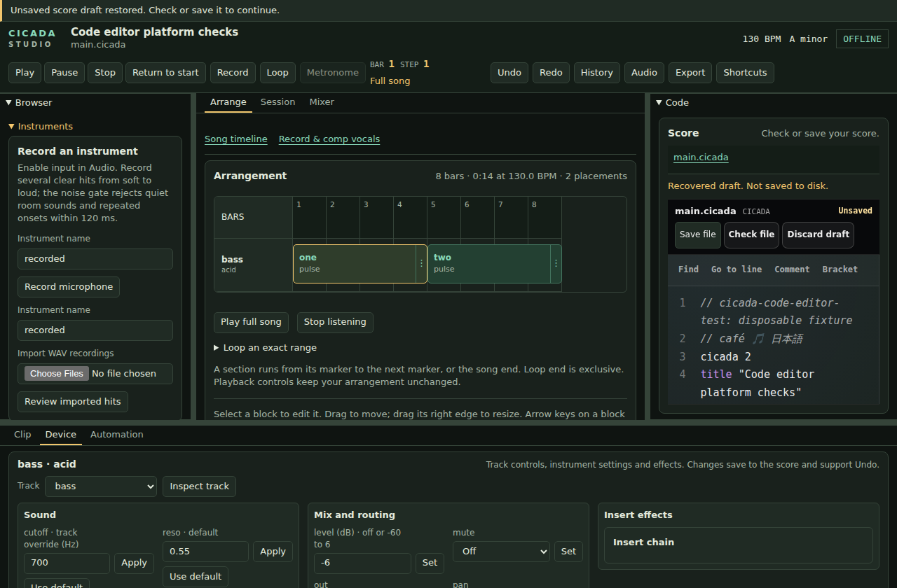

Recovery and editing controls also fit the [Code pane on a phone](screenshots/studio-code-recovery-390.png).

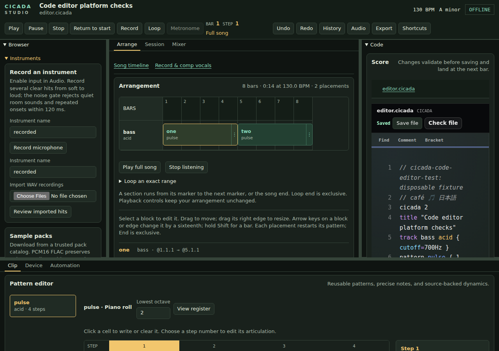

Find and Replace also fit the [Code pane on a phone](screenshots/studio-code-editor-390.png).

Every Studio edit is an intent: a small, named change such as toggling a step,
moving a song block, changing an arrangement placement, setting an automation
point, adding the vocal chain, comping a vocal take or placing a resampled
print. Studio records each committed edit, with its author and session, in the
edit log at `.cicada/edits.jsonl` next to the score. Undo, redo and restoring a
revision record the restore itself, with no intents, because they replay saved
bytes. A Session take recovered after a crash from its stored candidate source
is also logged without intents, because the journal keeps the candidate bytes
but not the edit that built them.
The `cicada apply` command runs intents through the same API, so a scripted
edit and a click in Studio produce the same bytes.

The file remains authoritative. If another editor saves first, Studio reports
a conflict and retains your draft. Reload **Score** to see the current file
beside it, combine the changes in the editor, and select **Save combined draft**.
Another save in the meantime causes a new conflict. **Discard draft** restores
the file without writing to it.

**History** shows source diffs and transport events. **Restore this revision**
restores a selected edit. **Undo** and **Redo** are available in the toolbar.
History changes also check the disk revision.

## Audio, takes, and export

**Audio** names the selected microphone and playback output and explains missing
or disconnected devices. **Refresh devices** checks the current list without
changing your routing; a disconnected saved choice stays selected until you
choose a replacement. Route controls unlock automatically after playback stops.
Technical errors are available under **Audio details**.

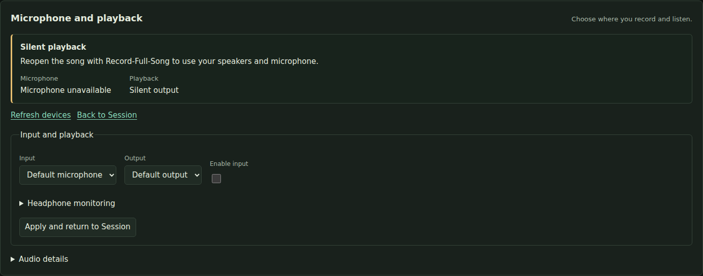

The controls also fit [phone screens](screenshots/studio-audio-setup-390.png).

**Audio** selects input and output devices, input enablement, monitoring mute,
gain, and stereo or mono channel selection. Stop playback before applying these
settings. Device errors stay visible; Cicada does not silently switch engines.

**Buffer size** offers 64, 128, 256, 512, or 1024 frames. Start with 128 for
recording, use 64 when your device and song meet that deadline, and increase
the buffer if playback drops out. Buffer size changes monitoring delay and
processing headroom while retaining the selected device sample rate and sound
quality. Stop playback and finish or disarm capture before changing it.

**Buffer and timing** updates the requested and granted buffer, audio thread
priority, peak callback cost, device deadlines and dropouts. Devices can grant a
larger period, including a period shared by the microphone and output. Native
rendering follows the actual callback demand without retaining an extra
256-frame render block. Input and output latency are driver reports; reported
round trip is their sum, and stays unknown when either report is unavailable.
A hardware loopback measurement is needed to confirm microphone-to-headphone
delay. Status polling does not open endpoints or repeatedly rediscover devices.

Unmuted native monitoring continues while capture is armed and through count-in.
Its gain only changes what you hear. Raw input is retained before monitoring,
and a period-sized capture queue gives the disk writer at least one second of
headroom without adding headphone latency.

**Arrange → Record & comp vocals** records across the full song, including
arrange-only scores. The toolbar's **Record** button, **F9**, or
**Command-Shift-R** on Mac (**Control-Shift-R** elsewhere) reveals these controls.
When recording is available, the same command starts a take or finishes the
active take. With no audio track, it shows **Recording setup**.

Earlier scene recordings appear under **Scene takes** for the selected audio
track. Preview a pass, then choose **Use in _scene_** to change that scene's
recording. The selected pass reads **In _scene_**. Undo and Redo restore the
selection; the original recordings remain available. Selection resolves imported
sounds and secondary score files. **Save As** carries both selected and unused
takes, audio assets, and pinned sound libraries into the copied project.

In **Recording setup**, choose a microphone and output in **Audio**,
enable input, and add an audio track such as `danilo`. Use headphones and leave
monitoring muted if the device delay is distracting. Native recording requires
Tymbal (`cicada studio score.cicada --audio tymbal`); Oto provides playback.

Recording setup explains whether your microphone is configured, off, or
unavailable. **Choose microphone and output** opens Audio with **Apply and return
to recording**, which returns to the same vocal track. Monitoring mute only
affects what you hear; it does not mute the recorded microphone.

**Microphone level** shows live mono or stereo input in dBFS while playback or
capture opens your configured input. Play the song and sing a phrase before
recording. Aim for peaks around −18 to −6 dBFS; adjust the microphone's input
volume or your distance from it. Monitoring gain changes headphone volume and
does not reduce input clipping. A peak marker keeps short overloads visible
between updates and after Stop, and resets with the next playback or take.
Polling microphone status does not open the device or create a recording.

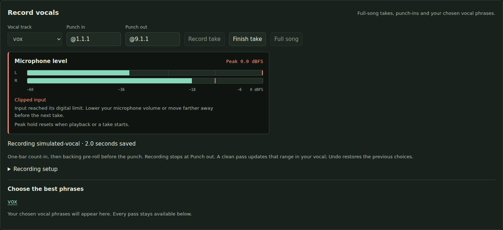

The same controls fit [phone screens](screenshots/studio-recording-levels-390.png).

The default **Punch in** and **Punch out** cover the complete song. **Full song**
resets both fields after a punch. Set either
to `@bar.beat.step` or exact ticks for a phrase, then **Record take**. A one-bar
count-in precedes playback; a punch starts its backing up to one bar earlier.
The previous vocal on that track is silent during capture. Recording stops
automatically at the mapped input frame for Punch out. **Finish take** ends a
pass early. The global **Stop & save take** button also drains and saves the
current native take. Conflicting playback commands are disabled during capture
across every panel; native requests enforce the same rule. Count-in is part of
that protected recording period. Count-in and backing pre-roll remain in the raw recording and are
excluded from the chosen vocal. Reported device timing compensates input delay;
**Recording timing** in Audio adds a manual correction for the remaining delay.
Positive **Recording timing correction (ms)** advances late input; negative
values delay it. The range is −500 to +500 ms. This preserves raw PCM and does
not reduce the latency of headphone monitoring. Automatic loopback measurement
is not implemented.

Choose **Passes** from 2 to 8 to record a punch range repeatedly. There is one
initial count-in; subsequent passes loop the selected backing without another
count-in or pre-roll. Every pass becomes a retained take lane. Stop saves the
current partial pass, and clean completion chooses the last usable pass while
keeping the earlier passes available for comping.

A clean completed pass replaces only its covered range in the vocal. Each take
remains under **Choose the best phrases**, in a waveform lane aligned to the
song's bars. Drag across a waveform to select a phrase. Drag either edge to trim
it, or the middle handle to move it. **Zoom** shows the whole song or fewer bars
for tighter edits; **Snap** offers sixteenth notes, beats, bars, or free ticks.

A playhead shows where playback is in the take lanes. **Loop selection** repeats
the selected phrase in your chosen listening mode until **Stop audition**; neither audition
changes the score. Space while focused on a waveform hears or stops the phrase.
**Follow song** advances the visible timeline at its edge when zoomed in.
Follow is optional and remembered with the other lane preferences.

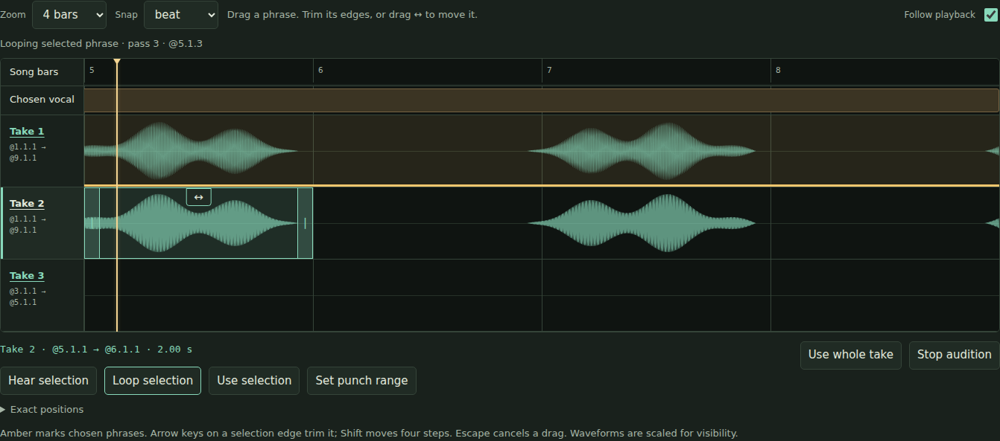

**Hear selection** auditions the selected phrase with backing without changing
the score. Set **Hear with** to **Vocal only** to hear the selected vocal without
backing; both modes use the track's effects. The same choice applies to loops
and waveform Space auditioning. It leaves track mute/solo settings unchanged.

**Phrase gain (dB)** adjusts a selection from −24 to +18 dB. Use the slider,
its arrow keys, or the number field to bring quieter and louder passes into
balance. **Hear selection** previews that level; **Use selection** saves it to
the chosen interval while preserving its neighbors and their levels. **Reset
gain** restores 0 dB in the editor; choose **Use selection** to save the reset.
Original recordings keep their PCM. **Use whole take** uses the pass's complete
covered interval at its original level.

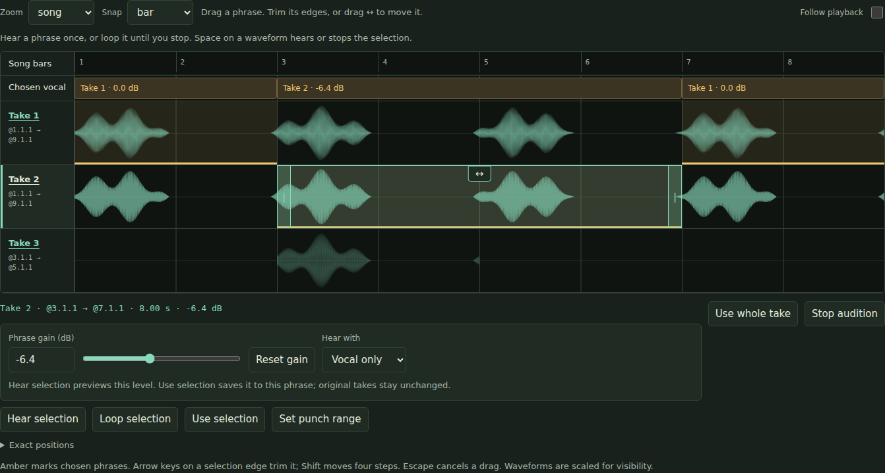

The level controls also fit [phone screens](screenshots/studio-vocal-levels-390.png).

Amber regions show which pass supplies each part, both in **Chosen vocal** and
on the take lanes, with each chosen phrase's gain beside its take name. Clicking
a chosen region recalls its range and saved gain. **Set punch range** copies
the selection into the recording fields; phrase gain does not change input gain.
Selections support Undo and Redo, and each join has a short fade to prevent clicks.

**Timing and transitions** gives the selected phrase its own **Advance phrase
(ms)**, **Edge fade (ms)** and **Join crossfade (ms)**. **Earlier 5 ms** and
**Later 5 ms** nudge timing without changing the selected song interval. Positive
advance reads later source samples so the voice arrives earlier. The native
editor rejects shifts without enough retained audio; it does not silently crop
or pad them. Edge fades accept 0–100 ms (default 5 ms); crossfades accept
0–100 ms (default 0). Joins use available recorded handles and clamp the overlap
to their coverage. Audition previews all these settings; **Use selection** saves
them, and clicking a chosen phrase recalls them. Raw recordings stay unchanged.

Arrow keys on a selection edge trim it; Shift moves four grid steps. Arrow keys
on the waveform move the phrase; Home/End move it to the take's boundaries.
Escape or a canceled touch gesture restores the range before a drag. **Exact
positions** retains the numerical range controls. Zoom, snap and unsaved
selection and uncommitted gain survive auditions and panel changes within the
browser tab. Undo/Redo restore the chosen phrase's saved level.

Waveforms use bounded peak summaries of the same mono signal as the comp,
excluding count-in and pre-roll and keeping punch takes at their song position.
Each waveform scales independently for visibility; its height does not compare
recording levels between takes. Waveform analysis does not edit or load the
entire recording into browser memory. If a waveform is unavailable, the take
stays retained and Exact positions remains available.

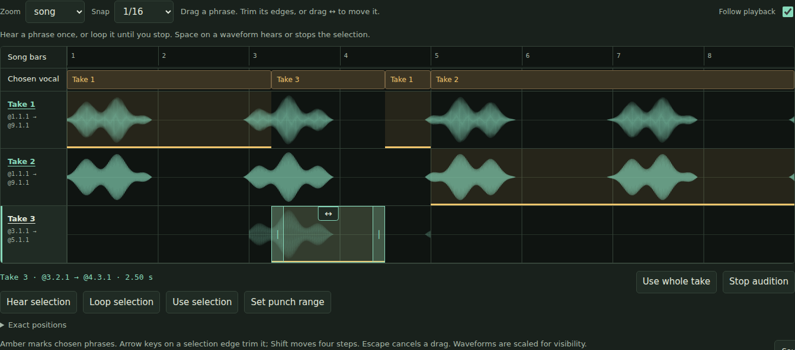

The same controls wrap for [phone-sized recording views](screenshots/studio-vocal-lanes-390.png).

Studio retains raw takes and their tempo/origin in the durable journal. The
chosen vocal is printed as a mono WAV (stereo input is averaged). Native playback
streams long audio clips from verified files through a bounded prefetch cache;
separate lead, double and harmony prints no longer consume the shared resident
sample budget. Short sampler assets retain a 64 MiB resident limit. A mono comp
print can contain up to 16,777,216 frames, about 5 minutes 49 seconds at 48 kHz.
Long takes are verified and read in bounded chunks when
printing the comp. Failed or conflicting passes remain available for selection.
**Follow song tempo (keep pitch)** is enabled for new Session recordings. It
keeps the raw recording and its journal unchanged, and prints a pitch-preserving
elastic version when you change the song's tempo or tempo steps in Studio.
The tempo and replacement vocal print save as one edit and undo together.
You can enable it on an existing chosen vocal in its phrase controls. With it
disabled, restore the recording's tempo map before combining mismatched takes.
Elastic processing runs outside the audio callback and supports mono vocal
prints at 8–192 kHz and half to double duration within the same frame limit as ordinary comps. It is intended
for vocal timing; extreme stretching, dense polyphonic material, and transient
percussion need listening checks. Per-syllable warp markers and pitch correction
are not included.

A scene-based song becomes ordinary arrangement placements on its first vocal
selection. Explicit part starts and **Keep** continuity carry over, and block
boundaries become markers. The original scene definitions remain available.
If scenes and the song are in separate project files, Studio converts only the
file containing the song. **Undo** restores its original song block and comments
together with the entry score. Numeric scene parameter changes become stepped
automation. Existing curves keep their shapes and take over at their original
first points; recall cues retain scene-boundary returns to those curves.
Tempo changes become bar-boundary steps inside `arrange`. Open **Tempo steps**
to change a step's **Bar** or **Tempo (BPM)**, add a step, or remove one.
**Save tempo step** moves and changes it in one edit; Undo restores that edit.
Steps start at bar boundaries, use 20–300 BPM, and cannot share a bar. The base
tempo in **Project settings** applies before the first step. Chosen vocals with
**Follow song tempo** enabled are reprinted for these edits. You can also write
`tempo @3.1.1 96` in the entry score in Studio's Code editor and save it.
Tempo edits in auxiliary Code files, external editors, and the standalone CLI
do not automatically reprint a vocal; select its
phrase again in Studio before playback/export. Recordings retain their original
tempo map for recovery and waveform analysis.
Toggle or symbolic values such as delay divisions still require
manual arrangement work; Studio refuses a conversion that cannot retain them.
Selecting a short phrase keeps a quiet song ending intact. Its arrangement span
can outlast the recorded audio without stretching or padding the recording.
Arrangement-only scores keep their existing placements and markers. Original
PCM and previous comp prints remain on disk for recovery and Undo. Simultaneous
multitrack input capture is not provided.

When the arrangement lives in a separate project source, a vocal selection
updates its placement there. Generated audio declarations and comp metadata
remain in the entry score. Previewing a selection leaves both sources unchanged;
**Undo** and **Redo** restore the committed sources together. Vocal effects and
automation remain editable after printing.

**Takes** retains the scene-based recording and sample audition workflow:
choose an audio track and scene, then **Arm take**, **Record**, and **Finish take**.
**Select take** commits a selected pass; **Recover take** retries publication
against the current revision. Arrangement takes can also be selected there.

Use **Add audio track** to create a recording lane in an edition-2 score. An
edition-1 score uses the explicit upgrade option in Mixer first. The Audio
tracks and clips section edits the source-frame start, exclusive end, gain, and
linear fades of each recorded region. **Place clip in scene** assigns it to an
audio track without modifying the recorded file. Region and assignment edits
check the source revision and support Undo. Arrangement audio blocks link here.

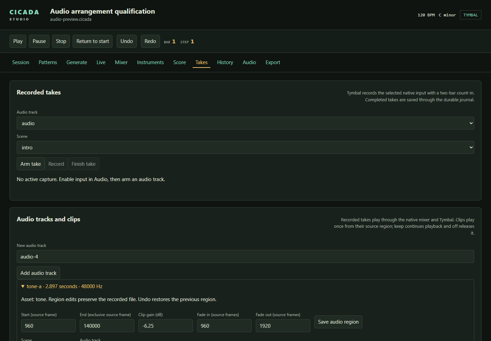

**Audition sample** opens a private preview of a published take. Choose its
root and playback MIDI notes and optional full-region looping, then **Update
audition** and use the audio controls. The native sample voice renders the WAV;
audition leaves the score unchanged and stops when you leave the panel.

Audio clips and declared sampler instruments play through the native mixer,
effects, meters, and Tymbal output, and are included in WAV and stems exports.
An explicit clip assignment starts its region when the scene is launched or a
song entry begins; `keep` continues it, and `off` releases it. A multi-bar entry
does not retrigger the clip each bar. Pause retains the source position, and
playing from a later block reconstructs an inherited clip's elapsed position.
Clips play once at their source rate; they are not stretched to fit scene bars.
Sampler patterns use the declared root pitch, voice budget, and oneshot or loop
mode; note gates release their voices. Supported playback ratios are 0.125–8.
**Live** does not offer sampler tracks; see [Live performance](#live-performance).

Assets are verified before playback, confined to the project directory, and
shared immutably between regions. Native playback streams long clip assets;
resident sampler-asset PCM is limited to 64 MiB, with 16 clips per audio track.
Sampler packs are not counted in that limit; native playback holds them under a
separate cap, 1 GiB by default, which `cicada studio --max-resident-pcm` or
`CICADA_MAX_RESIDENT_PCM` changes (see [instrument packs](../sampler/packs.md#memory-limits)).
Studio reads a pack's audio once, when the engine first needs it, and reuses that copy for every later request, edit and export. File
I/O and decoding never run in the audio callback. Offline WAV and stems exports
wait for pages outside rendering and fail explicitly on missing audio. While a new native take
records, the full project plays as accompaniment, including sampler tracks
and earlier audio takes. Capture stores device input before monitoring and
mixing, so the backing and monitoring gain are not printed into the take.
The portable AudioWorklet image uses the same sample-capable engine and
verified pack map as native playback and offline render. The portable image
keeps its 2 MiB size limit and its 64 MiB resident-PCM budget for assets and
packs together.

Resident stereo/sample assets retain their 8,388,608-frame limit. Recorded mono
assets support 16,777,216 frames; the native streamed clip path avoids loading
long vocals into the resident arena. Portable AudioWorklet/WAM projects retain
their resident image limits. Native Session streaming does not provide browser
worker page transfer.

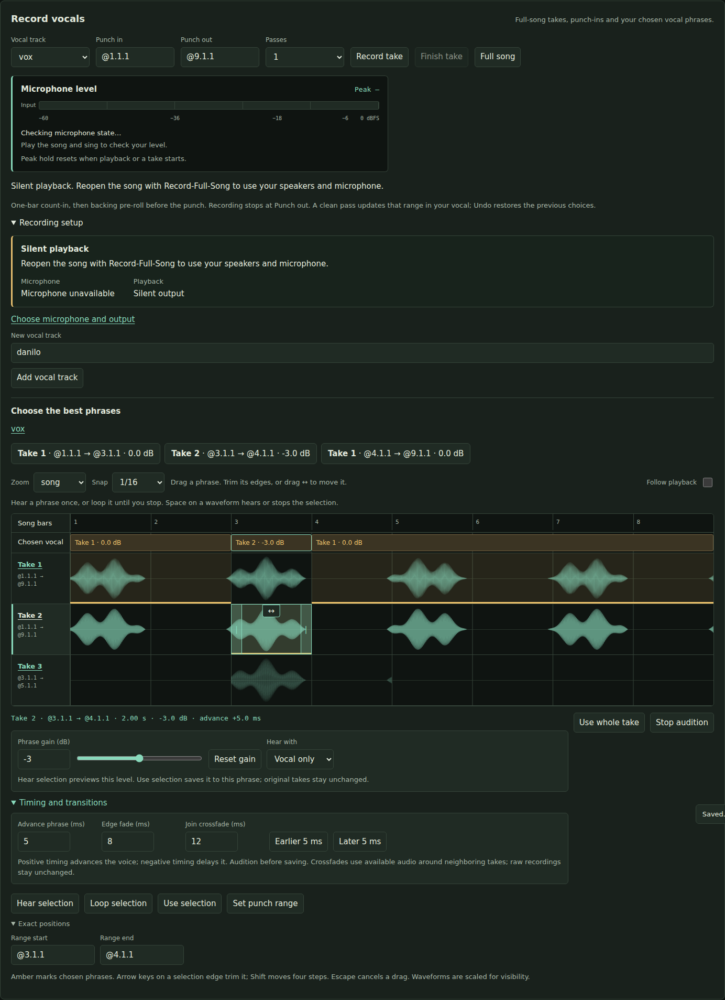

The same controls fit [phone screens](screenshots/studio-producer-vocal-timing-390.png).

### Library

The Library panel lists public instruments, kits, FX chains and presets from
standard, project and user libraries. Filter by kind or search by name and
library path. Select a track, or enter a new track name, then choose **Insert**.
Studio adds the import once and updates the library pins before committing the
validated source. Drive binds as an insert, delay and reverb bind as sends, and
compression binds on the music bus. Unsupported combinations leave the score
unchanged.

**Preview** plays a fixed one-bar phrase at 120 BPM through the selected audio
engine without changing the score. Only one preview plays at a time; starting
transport or switching audio mode stops it. Stop playback and recording before
previewing. Browser previews use the same kernel and AudioWorklet processor as
score playback.

To save a selected track's stored values, enter a preset name and choose
**Save as preset**. Studio resolves any existing preset and writes the current
non-default registry values into a new declaration in the score. Source edits
and preset saves support History undo and redo. Pins remain available for redo.

### Export

**Export** renders the saved song with a target LUFS value, true-peak ceiling,
tolerance, sample rate, and PCM depth. Save Code changes and keep retained
performances to include them in the render. Select **Render WAV** to start a
background job. Export stays open while progress, measured LUFS, true peak,
applied gain, limiter reduction, and the output filename update. **Download WAV**
appears when the current job completes. A shortfall render is labeled explicitly
for inspection before delivery. Export states whether the render matches the
saved score files and library definitions. If you save more edits, its link
changes to **Download earlier render**;
the earlier WAV remains available until you start another render. Undoing back
to the rendered score restores the matching label without rendering again.
Rendering checks the saved score files and library definitions loaded by Studio.
If they change before the job starts, refresh Studio and review the saved song
before rendering again. A rejected request keeps the previous WAV available.
Starting another job invalidates its previous download link. Audio stays outside
the public asset bundle, and long downloads stream through the private service.
Offline rendering uses the same Cicada kernel as Tymbal playback. See
[exporting](exporting.md) for stems, MIDI, and verification commands.

On Mac, selecting a WAV, MIDI, or stems download opens **Save Cicada export**.
Choose the destination and filename; canceling keeps the export available.
Studio in a browser uses the browser's download settings.

**Individual tracks (stems)** prepares the song for collaboration or a new mix
in another DAW. Choose 44.1, 48, or 96 kHz, select **Render stems**, and download
the ZIP when it completes. It contains aligned stereo float32 WAVs for every
track, both shared effects returns, the music and SFX buses, and a master
reference, plus a routing manifest. All files include the whole song and a
three-second tail. Track effects, levels, and pan are retained; stems do not
receive separate loudness normalization. Import the numbered tracks and effect
returns together; use the bus and master files as alternatives or references,
so the mix is not doubled.

The previous successful stems ZIP stays available while a new job runs or if
it fails. Saved edits mark the old ZIP as an earlier export. As with WAV, Studio
requires the saved project version you reviewed; a change in another score
file rejects the request and preserves the earlier download. WAV and MIDI
exports remain independent of the stems job.

## Browser support

Forms, editing, navigation, and transport commands also work with JavaScript
disabled. Live bindings, editor enhancements, MIDI, note input, and meters require the
GoSX browser runtime. The audio service continues to run natively.

## Safe editing

Studio edits the same `.cicada` source you can open in a text editor. It
validates a proposed change before writing, checks that the file revision has
not changed, and refuses writes when it detects an unresolved external
recovery file. If Studio reports a conflict, read the message, compare the
named recovery file with your current score, and resolve the edits before
continuing.

If you want Studio beside VS Code, install or run the extension described in
[Editors and notation tools](editors.md#vs-code).

Continuous automation appears below the Song lane. Each graph labels its parameter, range and musical endpoints; point descriptions retain positions, values and shapes for assistive technology. Edit `automate` blocks in the score and reload to update the curves. See [automation blocks](../spec/features.md#automation-blocks) and [the runnable example](../../examples/continuous-automation.cicada).

Input recording uses the native device selected in **Audio**. The current
Tymbal backend does not run in a browser AudioWorklet; native playback and
capture are independent of browser microphone permission. Legacy portable-host
adapters remain qualification fixtures and are excluded from Studio's
production routes.
