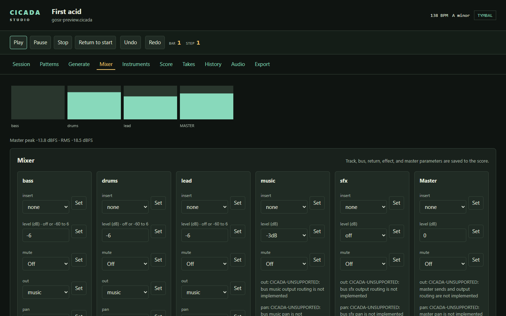
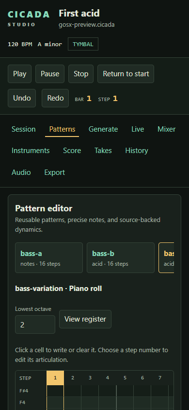

# Cicada Studio

Studio is a GoSX workstation for projects on disk. The Windows app starts
without a score by creating an untitled project in Documents\Cicada; **File → New**
creates another project. Explicit `cicada.mod` projects can contain several
score files. Its editor, forms, navigation, meters, and live performance use
GoSX; Tymbal handles native audio devices.
Changes to patterns, mixer settings, and arrangements write back to the score.

In the desktop app, **Arrange** opens on the song timeline, with vocal recording
below it. Edition-2 scores have **Song timeline** and **Record & comp vocals**
links to jump between them.
**Session** contains the launch matrix and live playing;
**Mixer** contains mix controls. Instruments, Generate, Takes, and Sampler are
in the left Browser. The detail dock's **Clip** tab edits patterns, **Device**
edits the selected track's sound and processing, and **Automation** contains
curve and scene-point editors. The **Code** lens shows the score. Older
screenshots show these tools as standalone panels.

Switching Arrange, Session, or Mixer, changing detail tabs, or choosing a
workspace region on a phone keeps your unsaved **Code** text in place.

**Sampler** adds sixteen stereo pads, waveform chopping, pitch and reverse,
effects, and performance resampling. A placement's **Sample into pads** link
opens it as a source; printed performances become regular arrangement audio
placements. See the [pad sampler guide](sampler.md).

From a source checkout, build both executables and open a score:

```sh
make build
./build/cicada studio examples/first-acid.cicada
```

Open the printed loopback URL. Playback starts only when you select **Play**.
`--audio null` exercises transport without an output device. On Windows and
Linux, the default is Tymbal. Use **Audio** to select its devices and input
monitoring settings while stopped.

The null backend is silent. In WSL or on a Linux desktop using PulseAudio,
select the system output explicitly with `--audio oto`. Rendered WAV and MP3
files can also be played in your usual music player.





## Transport, Arrange, and Session

**Play**, **Pause**, **Stop**, and **Return to start** control native playback.
The bar, step, backend, and errors update through GoSX live bindings. Valid
score edits become active at the next bar; during a shorter loop they become
active when the loop restarts. An invalid external edit leaves the last valid
score playing.

**Session** shows a scene-by-track matrix. Select a scene header to launch its
assignments, a pattern cell to queue one track, or **Stop** to stop a track.
Launches are quantized to the next bar. **Keep** preserves that track's slot.

**Arrange** shows scene blocks across all tracks, their bar ranges, and inherited
patterns. Click a scene header to play from that block, or a pattern clip to
open its editor. Expand a block to replace its scene, set its length, duplicate
it, remove it, or move it earlier or later.
**Add to arrangement** appends an existing scene. At least one block remains.
Structural changes to songs with intervening comments require a Score edit
so those comments keep their attachment. Local scene and bar edits preserve them.

For an edition-2 score using `arrange`, **Arrange** shows named placements on
a track timeline with section markers. Select a block to open its controls.
Drag it horizontally to move it, or drag its right edge to resize it. Arrow
keys on a block or edge change its start or length by a sixteenth; hold Shift
for a whole bar. Drag previews are saved only when released; Escape cancels.

The placement controls change the track, pattern or clip, exact **Start**,
and **Length**. Start accepts `@bar.beat.step` or exact ticks. Length accepts
bars, note divisions, or ticks, such as `4bars`, `1/8`, or `320ticks`.
**Make a copy**, **Remove placement**, **Add a placement**, and **Edit markers**
keep arrangement work in Arrange. At least one placement must remain.
Overlapping pattern placements, incompatible content, and stale writes are
rejected without changing the score; audio placements may overlap. Every edit
supports Undo. The **Placement list** shows exact starts and exclusive ends;
sub-sixteenth boundaries retain their exact ticks. Content links open the
pattern or clip editor. Returning from Score reads the current saved project.

With a placement inspected in Arrange, **Command-D** on Mac (**Control-D**
elsewhere) duplicates it after the existing placements on its track.
**Backspace** or **Delete** removes it; the last placement remains protected.
**Command-L** (**Control-L**) or the toolbar's **Loop** button loops that
placement in song context; repeat the command to stop the loop. These commands
respect text/editor focus, unsaved work, and active recording. Use Undo to
restore a duplicated or removed placement.

Choose a **Section** and **Loop section** to repeat from its marker to the next
marker, or the arrangement end. For scene-based songs, **Loop block** repeats
the selected song block. **Loop an exact range** accepts `@bar.beat.step` or
ticks for both boundaries; the end is exclusive. A loop can start between bars
and can be shorter than a bar.

Each placement offers **Audition solo**, **Audition in song**, **Loop solo**,
and **Loop in song**. Solo auditions play just that placement; song-context
auditions play every part active over the same range. Once-through auditions
stop at the placement's exclusive end. These controls use native playback and
leave the score, mixer solo/mute settings, and Undo history unchanged.

The transport shows the target, mode, and exact boundaries. **Pause** retains
the selection; **Play** resumes it, or restarts a completed audition. Moving
or trimming a placement, moving a section marker, and Undo update the selected
listening range at the next bar or loop restart. Removing the target stops
playback. **Play full song** restores all parts and starts at the beginning;
**Stop listening** clears the listening selection and stops playback.


**Project settings** changes the title, tempo, key, and scale. Tempo keeps up
to three decimal places. Changing the key retunes scale-degree notes; explicit
letter pitches keep their pitch. Every edit validates and checks the current
disk revision before saving, and has an Undo entry.


**Automation → Scene automation** shows parameter lanes alongside the song's scene
blocks. Choose a parameter and **Inspect parameter**, then choose a scene and
**Add or replace point**. Track level and pan, sends, supported synth controls,
and effect parameters use the shared parameter catalog. Values accept their units
(for example `1.25kHz`, `250ms`, or `-6.25dB`), and controls report the allowed
range and alternatives. Existing points can be edited or removed.

A point applies each time its scene starts, with the engine's parameter
smoothing. **●** marks an explicit point; **↳** carries the previous value.
Removing a point keeps that inherited value; add the score's default value
explicitly to reset it. Repeated uses of a scene share its points. Playback,
seek reconstruction, WAV exports, and stems use the same scene settings.
The scene tempo (`tempo`) can be added, changed, and removed the same way; it steps at the scene boundary and the arrangement length is the sum of the steps. Edits preserve surrounding source comments and support Undo. Scene lanes place
points at scene boundaries. **Automation curves** edits continuous `automate`
lanes across song or arrangement time: choose a parameter, double-click to add
a point, drag points, or use arrow keys. Points snap to sixteenths and stay
between their neighbors. **Transition** selects linear, smooth, step,
exponential or tension-controlled curves. **Save point** makes one Undo step;
**Remove selected point** removes it. Escape cancels a drag. The numerical fields
retain unit-aware entry, and **All saved curves** shows the complete overview.
Recording knob/fader movements is not implemented.


The editor also supports [touch editing on phone screens](screenshots/studio-producer-automation-390.png).


## Patterns

Choose a pattern from the library. The piano roll shows pitched patterns;
drum patterns show their authored lanes.

With browser scripting on, the **Piano-roll tools** start on **Select**. Click
a cell to inspect its step without changing it, or double-click an empty cell
to add a note or hit. Choose **Draw (B)** and a click writes or erases a cell.
Press **B** to switch between the two tools. With a cell focused, **Delete** or
**Backspace** clears its step, and the left and right arrow keys select the
neighboring step. In a notes pattern, with the selected note's cell focused, the
up and down arrows transpose it by a semitone; hold **Shift** for an octave.
Without browser scripting there are no tools: a click on a cell writes or
clears it. In either mode, choose a step number (starting at **1**) to inspect
that step without changing it.

**View register** moves the piano roll to another octave; the editor reports
notes outside the displayed register.

The step inspector sets note, tie, or rest; MIDI pitch; accent and slide;
ratchet from 1–8; and chance from 1–100%. Drum hits offer velocity levels
**1–9**, normal **x** (100), or accented **X** (127). Melodic dynamics use the
voice's accent behavior. **Pattern timing** edits swing, gate, and transpose,
and resizes patterns to 1–64 steps. Shortening removes the ending steps from
every lane; Undo restores them.

**Range editing** copies, clears, reverses, rotates, or transposes selected
steps. Copy writes at its destination without extending the pattern; overlapping
copies read the original range. Rotate wraps inside the selection. Transpose
changes note pitches while retaining articulation, rests, and ties. Drum lanes
support the first four operations. Each operation commits as one Undo entry.

**Create variation** duplicates a pattern with independent notes and no reserved
slot. Its current pitches are written explicitly, including a custom voice's
home octave. **Assign to scene** places it on a compatible track. Editing a
phrase-based pattern expands its phrase uses locally, preserving the shared
phrase and other patterns. Comments inside a phrase-use expression require a
Score edit instead of being discarded.


## Phrase generation

**Generate** creates deterministic acid phrases from a 64-bit seed, key,
scale, structure, density, articulation, swing, and gate. Eight scales and
8, 16, 32, or 64 steps are available. Seeds remain exact even above JavaScript's
integer precision limit.

**Preview phrase** leaves the open score unchanged. The preview belongs to
your browser session and expires after thirty minutes. Open **Mutate or evolve
the first bar** to select an operation or generation index. Check the steps
that must remain locked. A variation preserves those steps and the preview's
other patterns and arrangement. If an operation requires changing a lock,
Studio reports the conflict.

**Replace open score with this phrase** applies the complete reviewed preview.
It checks the original revision; it cannot overwrite another editor's save.
**Undo** restores the previous score.

## Live performance


**Live** plays the **Pitched track** you choose from the A/W/S/E/D/F/T/G/Y/H/U/J/K
keys or the onscreen keyboard. That list offers acid tracks, the modeled
keyboards, and authored instrument tracks; audio and sampler tracks are not
offered. The drum pads play the **Drum track** you choose and use General MIDI
notes. Press **Play** first; changing tracks, leaving the panel, or losing focus
releases held notes, and **Release notes** releases them on demand.
The launch matrix queues scenes or individual slots with the selected timing;
mint marks a playing slot and amber marks a queued slot. Its forms also work
without browser scripting.

**Enable MIDI** asks for browser permission without system-exclusive access.
Live then reads Note On, Note Off, and Control Change messages from each
connected input. Notes play the selected pitched track. On channel 10, General
MIDI drum notes play the selected drum track and other notes are ignored. Live
ignores every other message, including pitch bend, channel and polyphonic
pressure, and MPE zone setup, so an MPE controller plays plain notes without
per-note expression. Web MIDI supplies MIDI 1 packets; this input does not
decode MIDI 2 Universal MIDI Packets.

#### Record and Arm

Select a parameter, scene, slot, track stop, or transport target, then **Learn
next input**. Parameters learn controller messages; launches learn note
messages. **MIDI launch timing** chooses next beat, next bar, or one, two, or four
bars. Mapping and track selections are saved in this browser. **Clear mappings**
removes them. Browsers without Web MIDI can still use keyboard and drum pads.

Press **Play**, choose the **Pitched pattern** and **Drum pattern** to record
into, then select **Record notes**. Acid and drum recordings use separate
pattern targets. **Finish note take** retains the notes for review without
changing the score. Under **Retained note take**, **Commit notes to patterns**
quantizes the notes to the nearest step and **Discard note take** drops them;
after a commit, **Undo** restores the previous patterns. While you record, the
take stays in the page, and an interrupted take is retained in the tab's session
storage when available. If the score changes after you finish, the preview
stays and a message asks you to review the notes against the current patterns
before you choose **Apply notes to current score**. Server previews expire
after thirty minutes or when Studio closes.
Take commits support acid, drum, and eight-voice programmable tracks with
single-note takes. Existing chord patterns are refused without changing the
score; edit their chords in the grid or source pane. Chord recording is not
available through the take editor. An acid take turns a note that is still held
when the next one starts into a slide.

The Live panel records each note's pitch, timing, and velocity. It does not
record bend, vibrato, pressure, or timbre. To add expression, write `bend:`,
`vibrato:`, `pressure:`, and `timbre:` rows in **Score**; see [expression
rows](../spec/features.md#expression-rows).

## Mixer and instruments

Select a placement and open **Device** to shape its track, or choose another
**Track** and **Inspect track**. **Sound** includes controls for built-in voices
and declared instrument parameters. Units, ranges, and menu choices show the
values each control accepts. **Apply** saves the setting; **Use default**
removes that track's override. Each change supports Undo. **Mix and routing**
and **Insert effects** have their own controls below Sound.

**Mixer** edits track, bus, return, effect, and master fields supported by the
source patcher. Each **Set** writes one parameter. Unsupported fields explain
their limitation and remain available in **Score**.
Ranges, units, enum choices, and On/Off controls come from Cicada's parameter
registry. Existing track sends are included in their mixer strip.
Audio tracks offer **Add vocal chain**: a high-pass EQ, compressor and de-esser
in that order. A second click retains the existing vocal chain. Use the ordered
**Insert chain** controls to move or remove stages, and follow each effect name
to its parameter controls. These processors have independent state per track;
changes are saved and recompiled. Finish a vocal take before changing saved
mixer settings. See [track inserts](../audio/mix-chain.md#track-inserts) for
processor syntax and supported controls.


For an edition 1 score, first check **Upgrade score to edition 2 for this change**.
The domain service performs the migration and parameter edit together.
#### PCM capture and shared sampler audition

For tap slicing, velocity layers and round robins, use **Record your own
instrument** in the Record panel. See [recording instruments](recording-instruments.md)
for microphone, WAV import and offline pack commands.

Add an edition-2 audio track and a scene, stop transport, and open **Record**.
Choose the target **Audio track** and **Scene** before arming. The backing
includes synths, samplers and existing audio clips; capture retains device input
before monitoring and mixing.
The GoSX meter surface shows track and master peaks, RMS, momentary,
short-term and integrated LUFS, loudness range, true peak, and dropped blocks.
**Reset live loudness** begins a new measurement. The surface stops polling
when you leave the mixer. Offline export still provides the final loudness
verification.

**Instruments** offers six starting patches: Warm pad, Wide strings, Poly brass,
Silk pluck, Round bass, and Soft bell. **Add instrument and track** saves an
editable graph and its track in one Undo step. Five patches have eight-note
polyphony; Round bass is monophonic. Choose the new track in **Live** to play
it using the on-screen keyboard, typing keyboard, or MIDI. Bind a notes pattern
in **Arrange** to sequence it and include it in WAV exports.

Declared parameters show their default and current track override. Apply a
value to shape just that track; **Use default** removes its override. Values
use the parameter's declared unit. Each change is revision checked and can be
undone. Edit the complete graph in **Score**. Notes patterns support two- to
four-pitch chords, editable in the grid or source. Committed note takes currently
support single notes; overlapping polyphonic takes explain this limit instead
of discarding chord notes.

## Score and history

**Score** uses the GoSX code editor with syntax highlighting, a gutter, and
two-space indentation. **Score** lists the project files. Select a file, edit it, then use **Check file**
to review its diagnostics or **Save file** to validate and write that file. Other
score files retain their exact bytes. External changes refresh clean editors and
project views; unsaved drafts remain available for an explicit merge. Saved
revision files live in app data, with late writes from other editors retained. A rejected edit
keeps the file unchanged and retains the draft across reload and navigation.
Rejected drafts expire after thirty minutes or when Studio closes.

Every Studio edit is an intent: a small, named change such as toggling a step,
moving a song block, changing an arrangement placement, setting an automation
point, adding the vocal chain, comping a vocal take or placing a resampled
print. Studio records each committed edit, with its author and session, in the
edit log at `.cicada/edits.jsonl` next to the score. Undo, redo and restoring a
revision record the restore itself, with no intents, because they replay saved
bytes. A Session take recovered after a crash from its stored candidate source
is also logged without intents, because the journal keeps the candidate bytes
but not the edit that built them.
The `cicada apply` command runs intents through the same API, so a scripted
edit and a click in Studio produce the same bytes.

The file remains authoritative. If another editor saves first, Studio reports
a conflict and retains your draft. Reload **Score** to see the current file
beside it, combine the changes in the editor, and select **Save combined draft**.
Another save in the meantime causes a new conflict. **Discard draft** restores
the file without writing to it.

**History** shows source diffs and transport events. **Restore this revision**
restores a selected edit. **Undo** and **Redo** are available in the toolbar.
History changes also check the disk revision.

## Audio, takes, and export

**Audio** names the selected microphone and playback output and explains missing
or disconnected devices. **Refresh devices** checks the current list without
changing your routing; a disconnected saved choice stays selected until you
choose a replacement. Route controls unlock automatically after playback stops.
Technical errors are available under **Audio details**.


The controls also fit [phone screens](screenshots/studio-audio-setup-390.png).

**Audio** selects input and output devices, input enablement, monitoring mute,
gain, and stereo or mono channel selection. Stop playback before applying these
settings. Device errors stay visible; Cicada does not silently switch engines.

**Buffer size** offers 64, 128, 256, 512, or 1024 frames. Start with 128 for
recording, use 64 when your device and song meet that deadline, and increase
the buffer if playback drops out. Buffer size changes monitoring delay and
processing headroom while retaining the selected device sample rate and sound
quality. Stop playback and finish or disarm capture before changing it.

**Buffer and timing** updates the requested and granted buffer, audio thread
priority, peak callback cost, device deadlines and dropouts. Devices can grant a
larger period, including a period shared by the microphone and output. Native
rendering follows the actual callback demand without retaining an extra
256-frame render block. Input and output latency are driver reports; reported
round trip is their sum, and stays unknown when either report is unavailable.
A hardware loopback measurement is needed to confirm microphone-to-headphone
delay. Status polling does not open endpoints or repeatedly rediscover devices.

Unmuted native monitoring continues while capture is armed and through count-in.
Its gain only changes what you hear. Raw input is retained before monitoring,
and a period-sized capture queue gives the disk writer at least one second of
headroom without adding headphone latency.

**Arrange → Record & comp vocals** records across the full song, including
arrange-only scores. The toolbar's **Record** button, **F9**, or
**Command-Shift-R** on Mac (**Control-Shift-R** elsewhere) reveals these controls.
When recording is available, the same command starts a take or finishes the
active take. With no audio track, it shows **Recording setup**.

In **Recording setup**, choose a microphone and output in **Audio**,
enable input, and add an audio track such as `danilo`. Use headphones and leave
monitoring muted if the device delay is distracting. Native recording requires
Tymbal (`cicada studio score.cicada --audio tymbal`); Oto provides playback.

Recording setup explains whether your microphone is configured, off, or
unavailable. **Choose microphone and output** opens Audio with **Apply and return
to recording**, which returns to the same vocal track. Monitoring mute only
affects what you hear; it does not mute the recorded microphone.

**Microphone level** shows live mono or stereo input in dBFS while playback or
capture opens your configured input. Play the song and sing a phrase before
recording. Aim for peaks around −18 to −6 dBFS; adjust the microphone's input
volume or your distance from it. Monitoring gain changes headphone volume and
does not reduce input clipping. A peak marker keeps short overloads visible
between updates and after Stop, and resets with the next playback or take.
Polling microphone status does not open the device or create a recording.


The same controls fit [phone screens](screenshots/studio-recording-levels-390.png).

The default **Punch in** and **Punch out** cover the complete song. **Full song**
resets both fields after a punch. Set either
to `@bar.beat.step` or exact ticks for a phrase, then **Record take**. A one-bar
count-in precedes playback; a punch starts its backing up to one bar earlier.
The previous vocal on that track is silent during capture. Recording stops
automatically at the mapped input frame for Punch out. **Finish take** ends a
pass early. The global **Stop & save take** button also drains and saves the
current native take. Conflicting playback commands are disabled during capture
across every panel; native requests enforce the same rule. Count-in is part of
that protected recording period. Count-in and backing pre-roll remain in the raw recording and are
excluded from the chosen vocal. Reported device timing compensates input delay;
**Recording timing** in Audio adds a manual correction for the remaining delay.
Positive **Recording timing correction (ms)** advances late input; negative
values delay it. The range is −500 to +500 ms. This preserves raw PCM and does
not reduce the latency of headphone monitoring. Automatic loopback measurement
is not implemented.

Choose **Passes** from 2 to 8 to record a punch range repeatedly. There is one
initial count-in; subsequent passes loop the selected backing without another
count-in or pre-roll. Every pass becomes a retained take lane. Stop saves the
current partial pass, and clean completion chooses the last usable pass while
keeping the earlier passes available for comping.

A clean completed pass replaces only its covered range in the vocal. Each take
remains under **Choose the best phrases**, in a waveform lane aligned to the
song's bars. Drag across a waveform to select a phrase. Drag either edge to trim
it, or the middle handle to move it. **Zoom** shows the whole song or fewer bars
for tighter edits; **Snap** offers sixteenth notes, beats, bars, or free ticks.

A playhead shows where playback is in the take lanes. **Loop selection** repeats
the selected phrase in your chosen listening mode until **Stop audition**; neither audition
changes the score. Space while focused on a waveform hears or stops the phrase.
**Follow playback** advances the visible timeline at its edge when zoomed in.
Follow is optional and remembered with the other lane preferences.


**Hear selection** auditions the selected phrase with backing without changing
the score. Set **Hear with** to **Vocal only** to hear the selected vocal without
backing; both modes use the track's effects. The same choice applies to loops
and waveform Space auditioning. It leaves track mute/solo settings unchanged.

**Phrase gain (dB)** adjusts a selection from −24 to +18 dB. Use the slider,
its arrow keys, or the number field to bring quieter and louder passes into
balance. **Hear selection** previews that level; **Use selection** saves it to
the chosen interval while preserving its neighbors and their levels. **Reset
gain** restores 0 dB in the editor; choose **Use selection** to save the reset.
Original recordings keep their PCM. **Use whole take** uses the pass's complete
covered interval at its original level.


The level controls also fit [phone screens](screenshots/studio-vocal-levels-390.png).

Amber regions show which pass supplies each part, both in **Chosen vocal** and
on the take lanes, with each chosen phrase's gain beside its take name. Clicking
a chosen region recalls its range and saved gain. **Set punch range** copies
the selection into the recording fields; phrase gain does not change input gain.
Selections support Undo and Redo, and each join has a short fade to prevent clicks.

**Timing and transitions** gives the selected phrase its own **Advance phrase
(ms)**, **Edge fade (ms)** and **Join crossfade (ms)**. **Earlier 5 ms** and
**Later 5 ms** nudge timing without changing the selected song interval. Positive
advance reads later source samples so the voice arrives earlier. The native
editor rejects shifts without enough retained audio; it does not silently crop
or pad them. Edge fades accept 0–100 ms (default 5 ms); crossfades accept
0–100 ms (default 0). Joins use available recorded handles and clamp the overlap
to their coverage. Audition previews all these settings; **Use selection** saves
them, and clicking a chosen phrase recalls them. Raw recordings stay unchanged.

Arrow keys on a selection edge trim it; Shift moves four grid steps. Arrow keys
on the waveform move the phrase; Home/End move it to the take's boundaries.
Escape or a canceled touch gesture restores the range before a drag. **Exact
positions** retains the numerical range controls. Zoom, snap and unsaved
selection and uncommitted gain survive auditions and panel changes within the
browser tab. Undo/Redo restore the chosen phrase's saved level.

Waveforms use bounded peak summaries of the same mono signal as the comp,
excluding count-in and pre-roll and keeping punch takes at their song position.
Each waveform scales independently for visibility; its height does not compare
recording levels between takes. Waveform analysis does not edit or load the
entire recording into browser memory. If a waveform is unavailable, the take
stays retained and Exact positions remains available.


The same controls wrap for [phone-sized recording views](screenshots/studio-vocal-lanes-390.png).

Studio retains raw takes and their tempo/origin in the durable journal. The
chosen vocal is printed as a mono WAV (stereo input is averaged). Native playback
streams long audio clips from verified files through a bounded prefetch cache;
separate lead, double and harmony prints no longer consume the shared resident
sample budget. Short sampler assets retain a 64 MiB resident limit. A mono comp
print can contain up to 16,777,216 frames, about 5 minutes 49 seconds at 48 kHz.
Long takes are verified and read in bounded chunks when
printing the comp. Failed or conflicting passes remain available for selection.
Changing tempo requires restoring the take's recording tempo before comping;
recorded vocals are not time-stretched.

A scene-based song becomes ordinary arrangement placements on its first vocal
selection. Explicit part starts and **Keep** continuity carry over, and block
boundaries become markers. The original scene definitions remain available.
Arrangement-only scores keep their existing placements and markers. Original
PCM and previous comp prints remain on disk for recovery and Undo. Simultaneous
multitrack input capture is not provided.

**Takes** retains the scene-based recording and sample audition workflow:
choose an audio track and scene, then **Arm take**, **Record**, and **Finish take**.
**Select take** commits a selected pass; **Recover take** retries publication
against the current revision. Arrangement takes can also be selected there.

Use **Add audio track** to create a recording lane in an edition-2 score. An
edition-1 score uses the explicit upgrade option in Mixer first. The Audio
tracks and clips section edits the source-frame start, exclusive end, gain, and
linear fades of each recorded region. **Place clip in scene** assigns it to an
audio track without modifying the recorded file. Region and assignment edits
check the source revision and support Undo. Arrangement audio blocks link here.


**Audition sample** opens a private preview of a published take. Choose its
root and playback MIDI notes and optional full-region looping, then **Update
audition** and use the audio controls. The native sample voice renders the WAV;
audition leaves the score unchanged and stops when you leave the panel.

Audio clips and declared sampler instruments play through the native mixer,
effects, meters, and Tymbal output, and are included in WAV and stems exports.
An explicit clip assignment starts its region when the scene is launched or a
song entry begins; `keep` continues it, and `off` releases it. A multi-bar entry
does not retrigger the clip each bar. Pause retains the source position, and
playing from a later block reconstructs an inherited clip's elapsed position.
Clips play once at their source rate; they are not stretched to fit scene bars.
Sampler patterns use the declared root pitch, voice budget, and oneshot or loop
mode; note gates release their voices. Supported playback ratios are 0.125–8.
**Live** does not offer sampler tracks; see [Live performance](#live-performance).

Assets are verified before playback, confined to the project directory, and
shared immutably between regions. Native playback streams long clip assets;
resident sampler PCM is limited to 64 MiB, with 16 clips per audio track. File
I/O and decoding never run in the audio callback. Offline WAV and stems exports
wait for pages outside rendering and fail explicitly on missing audio. While a new native take
records, the full project plays as accompaniment, including sampler tracks
and earlier audio takes. Capture stores device input before monitoring and
mixing, so the backing and monitoring gain are not printed into the take.
The portable AudioWorklet image uses the same sample-capable engine and
verified pack map as native playback and offline render. The existing 2 MiB
project-image and 64 MiB native resident-PCM limits still apply.

Resident stereo/sample assets retain their 8,388,608-frame limit. Recorded mono
assets support 16,777,216 frames; the native streamed clip path avoids loading
long vocals into the resident arena. Portable AudioWorklet/WAM projects retain
their resident image limits. Native Session streaming does not provide browser
worker page transfer.


The same controls fit [phone screens](screenshots/studio-producer-vocal-timing-390.png).

### Library

The Library panel lists public instruments, kits, FX chains and presets from
standard, project and user libraries. Filter by kind or search by name and
library path. Select a track, or enter a new track name, then choose **Insert**.
Studio adds the import once and updates the library pins before committing the
validated source. Drive binds as an insert, delay and reverb bind as sends, and
compression binds on the music bus. Unsupported combinations leave the score
unchanged.

**Preview** plays a fixed one-bar phrase at 120 BPM through the selected audio
engine without changing the score. Only one preview plays at a time; starting
transport or switching audio mode stops it. Stop playback and recording before
previewing. Browser previews use the same kernel and AudioWorklet processor as
score playback.

To save a selected track's stored values, enter a preset name and choose
**Save as preset**. Studio resolves any existing preset and writes the current
non-default registry values into a new declaration in the score. Source edits
and preset saves support History undo and redo. Pins remain available for redo.
Studio continues to refuse multi-file source editing.

### History

**Export** renders WAV with a target LUFS value, true-peak ceiling, tolerance,
sample rate, and PCM depth. Progress, measured LUFS, true peak, applied gain,
limiter reduction, and the output path update through GoSX. **Download WAV**
appears when the current job completes. A shortfall render is labeled explicitly
for inspection before delivery. Rendering checks the displayed source revision;
starting another job invalidates its previous download link. Audio stays outside
the public asset bundle, and long downloads stream through the private service.
Offline rendering uses the same Cicada kernel as Tymbal playback. See
[exporting](exporting.md) for stems, MIDI, and verification commands.

## Browser support

Forms, editing, navigation, and transport commands also work with JavaScript
disabled. Live bindings, editor enhancements, MIDI, note input, and meters require the
GoSX browser runtime. The audio service continues to run natively.

## Safe editing

Studio edits the same `.cicada` source you can open in a text editor. It
validates a proposed change before writing, checks that the file revision has
not changed, and refuses writes when it detects an unresolved external
recovery file. If Studio reports a conflict, read the message, compare the
named recovery file with your current score, and resolve the edits before
continuing.

If you want Studio beside VS Code, install or run the extension described in
[Editors and notation tools](editors.md#vs-code).

Continuous automation appears below the Song lane. Each graph labels its parameter, range and musical endpoints; point descriptions retain positions, values and shapes for assistive technology. Edit `automate` blocks in the score and reload to update the curves. See [automation blocks](../spec/features.md#automation-blocks) and [the runnable example](../../examples/continuous-automation.cicada).

Input recording uses the native device selected in **Audio**. The current
Tymbal backend does not run in a browser AudioWorklet; native playback and
capture are independent of browser microphone permission. Legacy portable-host
adapters remain qualification fixtures and are excluded from Studio's
production routes.
